<p align="center">
  
</p>

<h1 align="center">Hostkeep</h1>

<p align="center">
  <strong>Ton VPS Linux dans la poche.</strong><br>
  Un panel d'administration léger pour surveiller ton serveur et agir dessus,<br>
  depuis un navigateur ou un téléphone, sans jamais ouvrir de shell root au web.
</p>

<p align="center">
  
  
  
  
  
  
</p>

<p align="center">
  <a href="#-en-bref">En bref</a> ·
  <a href="#-installation-en-une-ligne">Installation</a> ·
  <a href="#-comptes-et-rôles">Rôles</a> ·
  <a href="#-ce-que-tu-peux-faire">Fonctionnalités</a> ·
  <a href="#-sécurité">Sécurité</a> ·
  <a href="#-mise-à-jour">Mise à jour</a> ·
  <a href="#-dépannage">Dépannage</a>
</p>

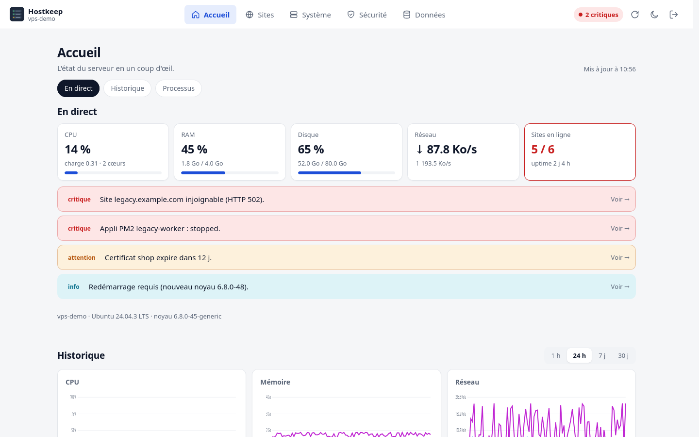

## ⚡ En bref

| Je veux… | Une commande (sur le serveur) |
|---|---|
| **Installer** | `curl -fsSL https://raw.githubusercontent.com/ydeloustal/HostKeep/main/install.sh \| sudo bash` |
| **Mettre à jour** | `sudo hostkeep update` (ou le bouton *Mettre à jour* du panel) |
| **Sauvegarder maintenant** | `sudo hostkeep backup` (bases + sites + configs, puis copie externe) |
| **Restaurer une base / des fichiers** | `sudo hostkeep restore db <jour> <base>` · `sudo hostkeep restore files <jour> www` |
| **Changer de serveur** | Panel › *Administration › Version* › **Archive de migration**, puis sur le nouveau serveur : `sudo bash restore.sh` ([détails](#-changer-de-serveur)) |
| **Désinstaller** | `sudo hostkeep uninstall` (`--purge` pour tout effacer) |

L'installateur détecte le système (Debian 12/13, Ubuntu 22.04/24.04), installe ce qui manque, vérifie l'espace disque, la mémoire, les ports et le DNS, **te montre un récapitulatif avant de toucher à quoi que ce soit**, puis crée la base, les droits, le service et le premier compte. Chaque étape est rejouable et annulée en cas d'erreur.

## ✨ Pourquoi Hostkeep ?

- **Tout au même endroit.** Charge du serveur, sites, certificats, services, sauvegardes, mises à jour, sécurité et journaux : ce qu'on va chercher en SSH tous les jours, réuni sur 5 pages.
- **Pensé pour le téléphone.** Barre d'onglets en bas, boutons de 44 px, tableaux affichés en cartes, application installable (PWA).
- **On agit, pas seulement on regarde.** Redémarrer un service, renouveler un certificat, restaurer une base, installer les mises à jour : un bouton, une confirmation, le résultat en direct.
- **Sûr par construction.** La page web tourne sans droits root. Les actions passent par un seul script en liste blanche, chaque argument est revalidé, tout est journalisé.
- **Multi-utilisateur.** Comptes, 4 rôles prédéfinis (Super Admin, Administrateur, Éditeur / Modérateur, Lecteur), sessions révocables, mot de passe oublié par e-mail.
- **Installé en une ligne.** Le script détecte Apache, Nginx, Caddy ou un reverse proxy (Traefik…), installe ce qui manque et ajoute le panel sans toucher aux autres sites.
- **Rien à compiler.** PHP natif, JavaScript vanilla, aucune dépendance front, aucun build.

## 📸 Aperçu

| Accueil | Recherche | Sites | Sécurité | Action en cours |
|---|---|---|---|---|
| 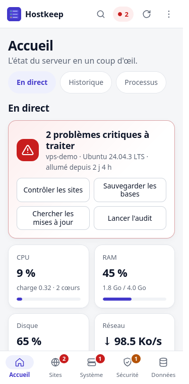 | 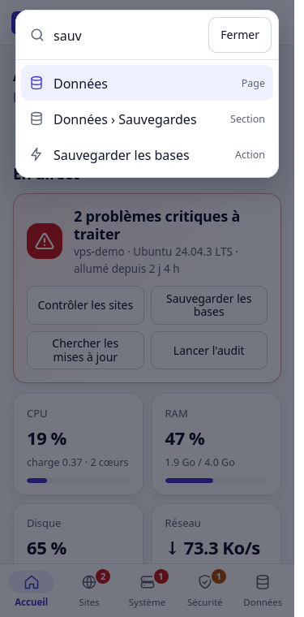 | 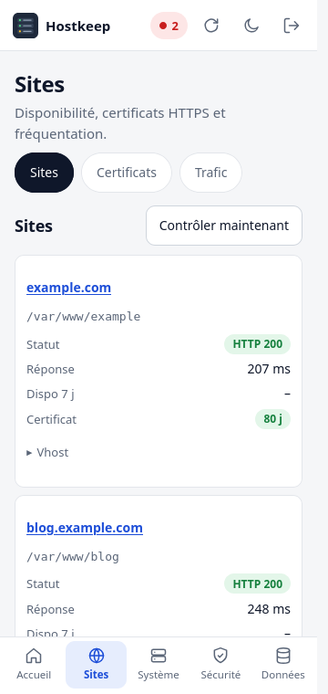 | 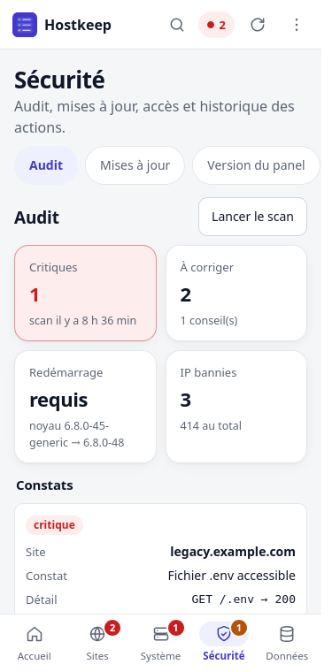 | 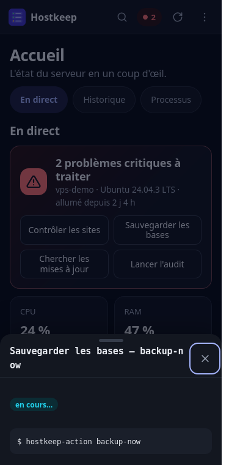 |

<details>
<summary><strong>Voir la version ordinateur et le thème sombre</strong></summary>

| Sites | Sécurité, thème sombre |
|---|---|
| 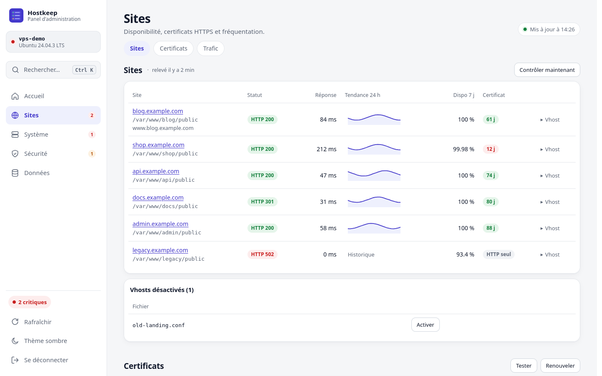 | 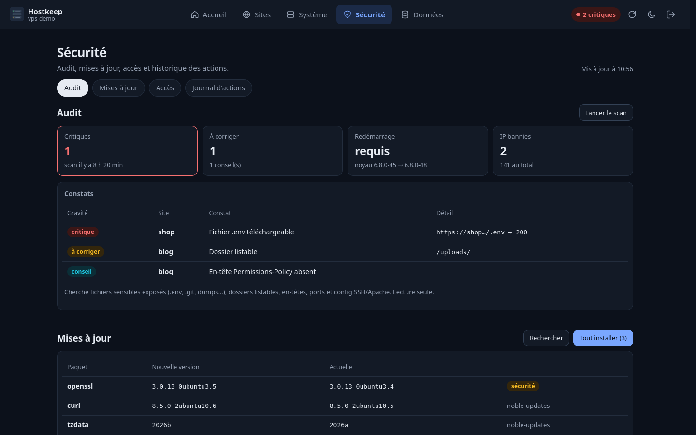 |

| Recherche et commandes (Ctrl K) | Connexion |
|---|---|
| 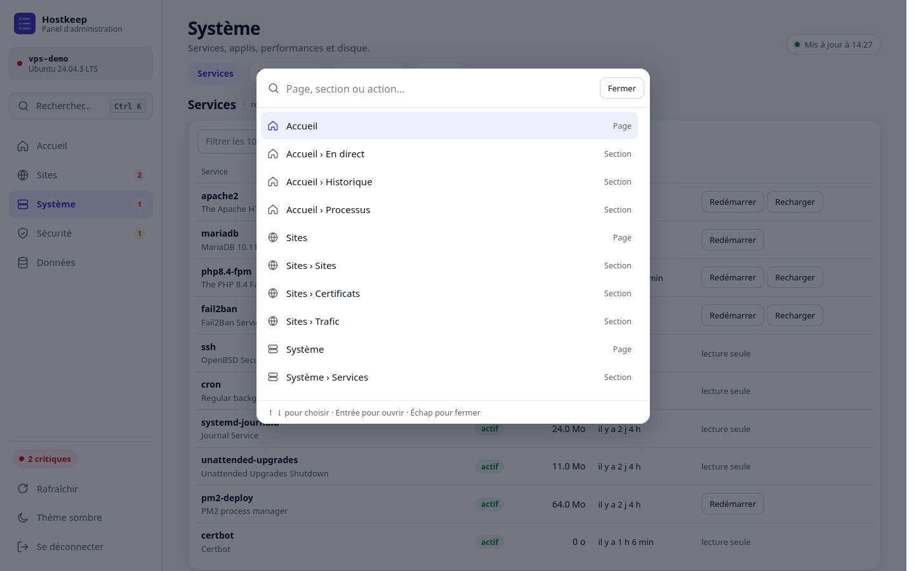 | 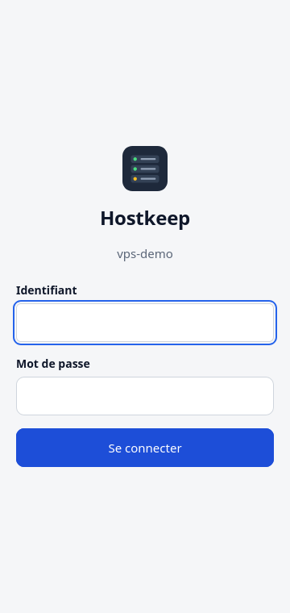 |

</details>

## 🧭 Ce que tu peux faire

| Page | Tu vois | Tu peux |
|---|---|---|
| **Accueil** | L'état général en une phrase, les alertes triées par gravité, CPU / RAM / disque / réseau en direct, l'historique de 1 h à 30 j, les processus gourmands | Lancer les contrôles courants en un geste : sites, sauvegarde, mises à jour, audit |
| **Sites** | Sites Apache **et** Nginx (lus dans leur configuration), code HTTP, temps de réponse, disponibilité sur 7 j, certificats Let's Encrypt, trafic (visiteurs, robots, 404/5xx, pages, référents) | Contrôler les sites, activer ou désactiver un vhost, tester et renouveler les certificats |
| **Système** | Services systemd, applis PM2, timers et crontabs, pools PHP-FPM, requêtes MariaDB lentes, partitions et gros dossiers | Redémarrer ou recharger un service, redémarrer une appli PM2, vider le cache apt, réduire le journal |
| **Sécurité** | Audit des sites (`.env`, `.git`, dumps exposés, dossiers listables, en-têtes, ports, SSH), mises à jour apt, fail2ban, ports ouverts, connexions SSH, journal des actions | Lancer l'audit, installer les mises à jour, redémarrer le serveur (avec `update-grub` si besoin), débannir une IP, mettre à jour le panel |
| **Données** | Bases MariaDB, sauvegardes quotidiennes (bases **et fichiers** : sites, configs Apache/Nginx, certificats), état de la copie externe, journaux filtrables, explorateur de fichiers en lecture seule | Sauvegarder, envoyer hors du serveur (S3, SFTP, Google Drive… via rclone), télécharger l'archive complète en un clic, restaurer une base (copie de sécurité automatique avant) |
| **Administration** | Comptes, rôles et permissions, paramètres du panel | Créer, inviter, désactiver des comptes ; régler le SMTP, les alertes (e-mail, Discord, Telegram, webhook), la surveillance externe, les sauvegardes, la sécurité ; changer de domaine |
| **Mon compte** | Profil, sessions ouvertes sur chaque appareil | Changer de mot de passe, fermer une session à distance |

### Une interface faite pour aller vite

| | |
|---|---|
| 🔎 **Recherche universelle** | `Ctrl K` (ou `/`, ou la loupe sur mobile) : tape « ssl », « disque » ou « sauvegarde » pour ouvrir la bonne section ou lancer une action. |
| ⌨️ **Raccourcis clavier** | `1` à `5` pour changer de page, `R` pour rafraîchir, `?` pour la liste. |
| 🧹 **Filtres instantanés** | Chaque tableau de plus de 8 lignes a son champ de filtre. |
| 🔔 **Actions en arrière-plan** | Ferme la fenêtre d'une action longue : elle continue, une notification t'annonce le résultat. |
| 📱 **Installable** | Sur téléphone et ordinateur (PWA), avec une page claire quand le serveur est injoignable. |
| 🌗 **Clair et sombre** | Suit le système, modifiable d'un clic. |
| ♿ **Accessible** | Navigation complète au clavier, contrastes AA, animations coupées si le système le demande. |
| 🔗 **Liens profonds** | Chaque section a son adresse, par exemple `#system/storage`. |

## 🚀 Installation en une ligne

**Il te faut :** un VPS **Debian 12 / 13** ou **Ubuntu 22.04 / 24.04** avec un accès `sudo`, et un **sous-domaine** (ex. `admin.mondomaine.fr`) dont l'enregistrement DNS `A` pointe vers le VPS (ports 80 et 443 ouverts).

```bash
curl -fsSL https://raw.githubusercontent.com/ydeloustal/HostKeep/main/install.sh | sudo bash
```

L'installateur pose quelques questions (domaine, serveur web, e-mail, premier compte) puis s'occupe de tout :

1. **Prérequis** : vérifie PHP ≥ 8.1, MariaDB, fail2ban, certbot… et n'installe **que ce qui manque**.
2. **Application** : copie le code dans `/var/www/hostkeep`, crée la base, le helper root, la commande `hostkeep` et le service **`hostkeep.service`** (PHP-FPM dédié, redémarré automatiquement), plus les timers de collecte.
3. **Serveur web** : détecte ce qui écoute sur les ports 80/443 et **ajoute** le panel comme nouveau site, sans modifier les autres (voir ci-dessous). Certificat **Let's Encrypt** et redirection HTTPS.
4. **Premier compte Super Admin** : tu choisis le mot de passe, ou un mot de passe temporaire est généré (à changer à la première connexion).

Ouvre ensuite `https://ton-domaine` et connecte-toi. 🎉

<details>
<summary><strong>Installation sans questions (automatisation)</strong></summary>

```bash
curl -fsSL https://raw.githubusercontent.com/ydeloustal/HostKeep/main/install.sh | sudo bash -s -- \
  --domain admin.mondomaine.fr --email moi@mondomaine.fr --web auto \
  --admin-user yoan --admin-email moi@mondomaine.fr --yes
```

| Option | Rôle | Défaut |
|---|---|---|
| `--domain D` | Domaine du panel | demandé |
| `--email E` | E-mail Let's Encrypt (alertes d'expiration) | vide |
| `--web MODE` | `auto`, `apache`, `nginx`, `caddy`, `proxy`, `none` | `auto` |
| `--https yes\|no` | Certificat Let's Encrypt + redirection | `yes` |
| `--listen ADDR` | Mode `proxy` : adresse HTTP locale du panel | `127.0.0.1:8090` |
| `--admin-user U`, `--admin-email E` | Premier Super Admin (mot de passe généré, affiché une fois) | `admin` |
| `--harden-apache` | Active aussi les règles Apache globales (bloque `.env`, `.git`, dumps… sur **tous** les sites) | non |
| `--repo URL`, `--branch B`, `--dir D` | Source du code | GitHub, `main`, `/opt/hostkeep` |
| `--yes` | Aucune question : options et valeurs par défaut | — |

Depuis un clone, les étapes se lancent aussi une par une : `sudo ./install.sh deps | app | web | admin | status | uninstall`.

</details>

### 🌐 Serveur web : détecté, jamais écrasé

| Détecté sur 80/443 | Ce que fait l'installateur |
|---|---|
| **Nginx** | Ajoute un server block `hostkeep.conf` (sites-available ou conf.d) et le journal de trafic `conf.d/hostkeep-traffic.conf` |
| **Apache** | Ajoute les vhosts `hostkeep.conf` / `hostkeep-le-ssl.conf` et le journal de trafic (GlobalLog) |
| **Caddy** | Ajoute `/etc/caddy/hostkeep.caddy` et une ligne `import` dans le Caddyfile ; HTTPS géré par Caddy |
| **Traefik, HAProxy, Nginx Proxy Manager, conteneur…** | Mode `proxy` : le panel écoute en HTTP local (`hostkeep-http.service`) ; route Traefik écrite si le fournisseur `file` est trouvé, sinon exemples dans `/etc/hostkeep/proxy-snippets.txt` |
| **Rien** | Propose d'installer Nginx (ou Apache, Caddy) |

Garde-fous : refus si le domaine est déjà servi par un autre site, refus de lancer un second serveur sur des ports déjà pris, `configtest` / `nginx -t` / `caddy validate` avant chaque rechargement, et **retour automatique à la configuration précédente** en cas d'erreur (y compris quand on change de mode ou de domaine). Le certificat se renouvelle tout seul (`certbot.timer`).

Changer plus tard : `sudo hostkeep web nginx`, `sudo hostkeep web --domain nouveau.domaine.fr`, ou depuis le panel (*Administration › Général › Changer de domaine*, Super Admin).

## 👥 Comptes et rôles

Les comptes se gèrent dans **Administration › Utilisateurs** (ou en ligne de commande, voir plus bas). Chaque rôle a tous les droits des rôles en dessous ; le serveur vérifie les droits à **chaque** requête, l'interface masque simplement ce qui n'est pas permis.

| | Lecteur | Éditeur / Modérateur | Administrateur | Super Admin |
|---|:---:|:---:|:---:|:---:|
| Tableaux de bord (état, sites, système, sécurité, bases) | ✔ | ✔ | ✔ | ✔ |
| Contrôles (sites, audit, mises à jour dispo., test des certificats, sauvegarde) | | ✔ | ✔ | ✔ |
| Redémarrer un service / une appli PM2, débannir une IP, lire les journaux | | ✔ | ✔ | ✔ |
| Actions système (vhosts, certificats, `apt upgrade`, nettoyage, restauration de base) | | | ✔ | ✔ |
| Fichiers, téléchargement des sauvegardes, journal des actions | | | ✔ | ✔ |
| Comptes de rang inférieur, paramètres généraux / SMTP / alertes / sauvegardes | | | ✔ | ✔ |
| Comptes administrateurs, paramètres de sécurité, mise à jour du panel, domaine | | | | ✔ |

- **Création** : mot de passe temporaire généré (affiché une fois, à changer à la première connexion), invitation par e-mail (lien valable 72 h), ou mot de passe choisi.
- **Connexion** par identifiant ou e-mail ; **mot de passe oublié** par e-mail si le SMTP est configuré.
- **Double authentification (TOTP)** : un code à 6 chiffres d'une application (Aegis, Google Authenticator, FreeOTP, Bitwarden, 1Password…) en plus du mot de passe. **Obligatoire par défaut pour les Administrateurs et Super Admins** : à leur prochaine page, ils scannent un QR code et reçoivent 10 codes de secours à usage unique. Réglable dans *Paramètres › Sécurité* (admins, tous, personne). Téléphone et codes perdus : un compte de rang supérieur la réinitialise (*Utilisateurs › …*), ou `sudo hostkeep 2fa-reset <identifiant>`.
- **Sessions** : chaque appareil connecté est listé et peut être déconnecté (*Mon compte*, ou par un administrateur). Changer de rôle, désactiver un compte ou changer de mot de passe ferme les autres sessions.
- Le dernier Super Admin actif ne peut être ni supprimé, ni désactivé, ni rétrogradé.

## ⚙️ Paramètres (Administration)

| Section | Réglages |
|---|---|
| **Général** | Nom du panel, adresse publique (liens des e-mails), domaine et serveur web (affichage, changement de domaine) |
| **E-mails (SMTP)** | Serveur, port, STARTTLS / TLS, identifiants (mot de passe chiffré en base), expéditeur, **e-mail de test** |
| **Alertes** | Envoi des nouvelles alertes (critiques, ou critiques + avertissements) et de leur résolution, par **e-mail**, **Discord** (webhook), **Telegram** (bot) et **webhook JSON** générique (n8n, ntfy, Gotify…) ; bouton de test |
| **Surveillance externe** | URL de ping **Healthchecks.io** ou **Uptime Kuma** (« Push ») appelée chaque minute : si le serveur s'éteint ou perd le réseau, c'est ce service qui te prévient. Bouton de test, état du dernier ping |
| **Sauvegardes** | Activation, heure (appliquée au timer systemd dans la minute), fichiers inclus ou non, conservation des bases et des fichiers, exclusions |
| **Sauvegarde externe** | Destination rclone (S3, SFTP, ou toute configuration rclone : Google Drive, Dropbox…), dossier distant, conservation à distance, **chiffrement** (rclone crypt), limite de débit, bouton **Tester la connexion** |
| **Sécurité** | Double authentification obligatoire (admins, tous, personne), déconnexion après inactivité, longueur minimale des mots de passe, seuil et durée de blocage, « mot de passe oublié », **liste d'IP autorisées** (refusée si elle exclut ton adresse) |

Les réglages du serveur lui-même (domaine, mode web, version de PHP, services affichés, dossiers de l'explorateur) sont dans `/var/www/hostkeep/.env`, documenté dans [`.env.example`](.env.example).

## ⌨️ La commande `hostkeep`

```bash
sudo hostkeep status                    # état du panel, des services et du serveur web
sudo hostkeep admin                     # crée le premier Super Admin
sudo hostkeep users                     # liste les comptes
sudo hostkeep user create bob --role=editor --email=bob@exemple.fr --generate
sudo hostkeep passwd bob [--generate]   # nouveau mot de passe (ferme ses sessions)
sudo hostkeep unlock bob                # débloque un compte après des échecs
sudo hostkeep 2fa-reset bob             # retire la double authentification (téléphone perdu)
sudo hostkeep web [mode] [--domain D]   # reconfigure la publication
sudo hostkeep update                    # git pull + réinstallation
sudo hostkeep backup                    # sauvegarde maintenant (bases + fichiers + copie externe)
sudo hostkeep restore list              # jours sauvegardés sur ce serveur
sudo hostkeep restore fetch [jour]      # jours de la copie externe, ou en rapatrie un ici
sudo hostkeep restore files <jour> www  # extrait une archive à part (--in-place pour remplacer)
sudo hostkeep restore db <jour> <base>  # restaure une base (copie de l'état actuel avant)
sudo hostkeep logs                      # journaux du service et du collecteur
```

<details>
<summary><strong>Ce que fait exactement <code>install.sh app</code></strong></summary>

La commande est idempotente : tu peux la relancer sans risque.

- crée l'utilisateur système `hostkeep` (sans shell ni dossier personnel) ;
- copie l'application dans `/var/www/hostkeep` et crée le `.env` en `root:hostkeep 640` (avec une clé de chiffrement aléatoire) ;
- crée ou met à jour la base `hostkeep` (accès par socket Unix, droits minimaux) et importe le compte unique de Hostkeep 1.x ;
- installe le helper root `/usr/local/sbin/hostkeep-action`, la règle sudo qui n'autorise que lui et la commande `/usr/local/bin/hostkeep` ;
- installe **`hostkeep.service`** : un PHP-FPM dédié (`/etc/hostkeep/php-fpm.conf`), confiné par `open_basedir` et le sandboxing systemd, redémarré automatiquement ;
- active la jail fail2ban `hostkeep` et les **timers systemd** de collecte (minute, 5 min, heure, nuit).

</details>

<details>
<summary><strong>Pourquoi pas Docker ?</strong></summary>

Hostkeep pilote l'hôte lui-même (systemctl, apt, fail2ban, certbot, vhosts). Dans un conteneur, il faudrait le lancer en mode privilégié avec le système de fichiers de l'hôte monté, ce qui annulerait tout le modèle de sécurité (sudo limité à une liste blanche). L'installation native avec systemd est donc le mode de production recommandé.

</details>

## 🔔 Être prévenu, même quand le serveur est éteint

Les alertes (*Paramètres › Alertes*) partent **du serveur** : e-mail, Discord, Telegram ou webhook JSON, une fois quand l'alerte apparaît, une fois quand elle se résout. Mais un serveur éteint ne prévient personne. D'où la **surveillance externe** (*Paramètres › Surveillance externe*) :

1. Crée un check gratuit sur [healthchecks.io](https://healthchecks.io) (période **1 minute**, marge **5 minutes**) ou un moniteur « Push » dans ton Uptime Kuma.
2. Colle son URL de ping dans Hostkeep, puis **Envoyer un ping de test**.
3. Le collecteur l'appelle chaque minute. S'il échoue, il envoie un signal d'échec (Healthchecks, Kuma) ; s'il ne l'appelle plus du tout (serveur éteint, réseau coupé, collecteur bloqué), le service t'alerte par ses propres moyens (e-mail, SMS, Telegram…).

## 💾 Sauvegarder et restaurer

Chaque nuit (heure réglable), Hostkeep range dans `/var/backups/hostkeep/AAAA-MM-JJ/` :

| Quoi | Fichier | Conservation par défaut |
|---|---|---|
| Chaque base MariaDB | `<base>.sql.gz` | 7 jours |
| `/var/www`, `/etc/apache2`, `/etc/nginx`, `/etc/letsencrypt`, `/etc/hostkeep` | `files/<nom>.tar.gz` (lisible par root seulement) | 3 jours |
| Ce qui a été fait, tailles, sommes SHA-256, erreurs | `manifest.json` | — |

Avant d'archiver les fichiers, Hostkeep vérifie qu'il reste assez de place (et garde 1 Gio libre) : sinon il saute cette partie et lève une alerte, plutôt que de remplir le disque.

**Copie hors du serveur.** Dans *Administration › Paramètres › Sauvegarde externe*, choisis une destination (S3, SFTP, ou une configuration rclone pour Google Drive, Dropbox…), une phrase de chiffrement (recommandé), puis **Tester la connexion**. Chaque jour est copié juste après la sauvegarde ; un envoi raté est retenté toutes les heures. L'accueil affiche l'heure de la dernière copie réussie, et une alerte se lève après 36 h sans copie.

**Restaurer.**

```bash
# une base : depuis le panel (Données › Sauvegardes › Restaurer), avec une copie de l'état actuel juste avant
sudo hostkeep restore list                          # ce qui est sur ce serveur
sudo hostkeep restore files 2026-11-20 www          # extrait /var/www du 20/11 dans /var/backups/hostkeep/restore/, sans rien écraser
sudo hostkeep restore files 2026-11-20 nginx --in-place   # remplace /etc/nginx (demande confirmation)
```

**Serveur perdu ?** Installe Hostkeep sur le nouveau serveur, remets les mêmes réglages de *Sauvegarde externe* (même phrase de chiffrement), puis :

```bash
sudo hostkeep restore fetch               # liste les jours disponibles à distance
sudo hostkeep restore fetch 2026-11-20    # les rapatrie et vérifie les sommes de contrôle
```

> Garde la phrase de chiffrement **ailleurs que sur le serveur** : sans elle, les copies externes sont illisibles.

## 🏗️ Comment ça marche

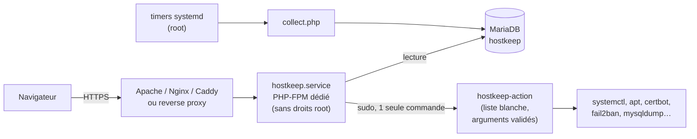

| Couche | Choix |
|---|---|
| **Back-end** | PHP 8.1+ natif (sans framework), PHP-FPM dédié lancé par `hostkeep.service` |
| **Comptes** | Table `users` (hash bcrypt/argon), sessions doublées en base (révocables), RBAC à 4 rôles, client SMTP intégré |
| **Front-end** | JavaScript vanilla, graphiques SVG faits maison, CSS sans préprocesseur |
| **Données** | MariaDB par socket Unix : aucun mot de passe de base stocké |
| **Système** | Timers systemd pour la collecte, sudo restreint à un helper bash, fail2ban, logrotate |
| **Web** | Apache 2.4, Nginx, Caddy ou tout reverse proxy ; HTTPS Let's Encrypt (certbot) |

## 🔒 Sécurité

Le panel a des pouvoirs d'administration : **protège-le comme un accès SSH.**

**Déjà en place**

- Aucun mot de passe par défaut : le premier compte est créé à l'installation, un mot de passe temporaire doit être changé à la première connexion.
- Droits vérifiés côté serveur à chaque requête (RBAC), comptes de rang supérieur intouchables, journal de chaque action (connexions, comptes, paramètres, actions root).
- Page web exécutée **sans droits root**, actions limitées à une liste blanche, arguments revalidés côté root.
- Session expirée après 30 min d'inactivité (réglable), sessions révocables, cookie `Secure` + `HttpOnly` + `SameSite=Strict`, protection CSRF, CSP stricte, HSTS.
- **Double authentification TOTP** obligatoire pour les comptes administrateurs (réglable), secret chiffré, un code ne sert qu'une fois, codes de secours hachés.
- Blocage après 5 échecs par IP **et** par compte (réglable), puis bannissement fail2ban.
- Mot de passe SMTP chiffré (AES-256-GCM), liens de réinitialisation à usage unique (seul leur hash est stocké).
- Journal de toutes les actions. Explorateur de fichiers en lecture seule, clés privées toujours refusées.
- `.env` hors de la racine web, lisible seulement par root et le groupe `hostkeep`, ignoré par Git.

**À faire de ton côté**

1. Donne à chacun son propre compte avec le rôle le plus bas suffisant, et un mot de passe long et unique.
2. N'expose jamais le panel en HTTP simple.
3. Ferme tout ce qui n'est pas nécessaire :

   ```bash
   sudo apt-get install -y ufw
   sudo ufw allow OpenSSH
   sudo ufw allow 80,443/tcp
   sudo ufw enable
   ```

4. Si ton IP est fixe ou si tu passes par un VPN, **restreins l'accès par IP** dans *Administration › Sécurité › Adresses IP autorisées*.

## 🔄 Mise à jour

**Depuis le panel :** *Sécurité › Version du panel*, bouton **Mettre à jour** (Super Admin). Le panel vérifie chaque heure s'il y a des nouveautés sur GitHub et l'affiche dans les alertes. Un bouton **Revenir à…** réinstalle la version précédente.

**En SSH :** `sudo hostkeep update` (ou relancer la commande d'installation en une ligne).

Le code est remplacé ; le `.env`, la base (comptes, paramètres), les sauvegardes et la configuration du serveur web sont conservés.

> **Depuis Hostkeep 1.x :** la mise à jour importe automatiquement l'ancien compte unique comme Super Admin (même mot de passe), remplace l'ancien pool PHP-FPM par `hostkeep.service` et bascule le vhost existant dessus.

## 🚚 Changer de serveur

1. Sur l'ancien serveur, dans le panel : *Administration › Version* › **Télécharger l'archive de migration** (Super Admin). Coche « Inclure les comptes » pour les emporter, chiffrés par une phrase de passe.
2. Sur le nouveau serveur, fais pointer le DNS du panel vers lui, copie l'archive, puis :

   ```bash
   tar -xzf hostkeep-migration-*.tar.gz && cd hostkeep-migration-*/
   sudo bash restore.sh            # --domain autre.domaine.fr pour en changer
   ```

   `restore.sh` installe Hostkeep (même branche depuis GitHub, ou le code de l'archive hors ligne), réimporte les réglages et les comptes, publie le panel et liste ce qu'il reste à faire.
3. Ressaisis les secrets (jamais dans l'archive : SMTP, sauvegarde externe, alertes, ping), puis rapatrie les données depuis la copie externe : `sudo hostkeep restore fetch`, `restore db`, `restore files`.

L'archive contient le code, les réglages **sans secret**, les comptes **chiffrés** (si demandé, jamais les secrets de double authentification) et une notice ([`docs/RESTORE.md`](docs/RESTORE.md)).

## 🗑️ Désinstallation

```bash
sudo hostkeep uninstall           # retire le panel, garde la base (comptes), les sauvegardes et /var/www/hostkeep
sudo hostkeep uninstall --purge   # supprime aussi la base, les sauvegardes, les logs et l'utilisateur
```

Les autres sites ne sont pas touchés. Le certificat Let's Encrypt est conservé (`sudo certbot delete --cert-name ton-domaine` pour le retirer), de même que la protection Apache globale si tu l'avais activée.

## 🩺 Dépannage

| Symptôme | Cause probable | Solution |
|---|---|---|
| `pas de certificat` pendant l'installation | Le DNS ne pointe pas (encore) vers le VPS, ou le port 80 est fermé | `dig +short ton-domaine`, ouvre le port 80, puis `sudo hostkeep web` |
| « Aucun compte n'existe encore » | Installation interrompue avant la création du compte | `sudo hostkeep admin` |
| Mot de passe perdu, compte verrouillé | — | `sudo hostkeep passwd identifiant --generate`, `sudo hostkeep unlock identifiant` |
| Bloqué par la liste d'IP autorisées | Ton IP a changé | `sudo mysql hostkeep -e "DELETE FROM settings WHERE name='security.ip_allowlist'"` |
| Page inaccessible depuis ton IP | Bannissement fail2ban | `sudo fail2ban-client set hostkeep unbanip TON_IP` |
| Erreur 502 / 503 | `hostkeep.service` arrêté | `sudo hostkeep status`, `sudo hostkeep logs`, puis `sudo /opt/hostkeep/install.sh app` |
| Alerte « Le collecteur ne remonte plus de mesures » | Timers arrêtés ou erreur de collecte | `systemctl list-timers 'hostkeep-*'` et `journalctl -u 'hostkeep-collect@*' -n 50` |
| E-mails non reçus | SMTP mal réglé | *Administration › E-mails › Envoyer un e-mail de test* affiche l'erreur exacte du serveur |
| Pages *Sites* et *Trafic* vides | Ni Apache ni Nginx actifs (Caddy et les reverse proxy ne sont pas lus), ou collecte pas encore passée | « Contrôler maintenant », ou `sudo hostkeep collect` |
| Un site Nginx manque dans *Trafic* | Il a son propre `access_log` | Ajoute `include snippets/hostkeep-traffic.conf;` dans son bloc `server`, puis recharge Nginx (la page *Trafic* liste les sites concernés) |
| « Session expirée, réessaie » à la connexion | Cookie bloqué, ou proxy qui ne transmet pas `X-Forwarded-Proto` | Ouvre l'adresse en `https://` ; vérifie la configuration du proxy |

**Où regarder :** `sudo hostkeep logs`, `/var/log/hostkeep/` (connexions, erreurs PHP), et les journaux du serveur web.

## 📁 Structure du dépôt

```
app/
  public/       pages servies (index, connexion, mot de passe, API JSON) et assets (JS, CSS)
  src/          authentification, rôles (rbac), comptes, paramètres, SMTP, actions, collecteurs
  bin/          collecteur (root), schéma SQL, gestion des comptes en ligne de commande
system/         helper root, commande hostkeep, sudoers, PHP-FPM, services et timers systemd, fail2ban, logrotate
docs/           captures d'écran et maquettes d'étude (docs/mockups)
install.sh      installateur (une ligne, deps, app, web, admin, status, uninstall)
.env.example    configuration du serveur, commentée
```

L'historique des versions est dans [`CHANGELOG.md`](CHANGELOG.md).

## 📄 Licence et auteur

Distribué sous licence [MIT](LICENSE). Conçu et développé par **Yoan**.
