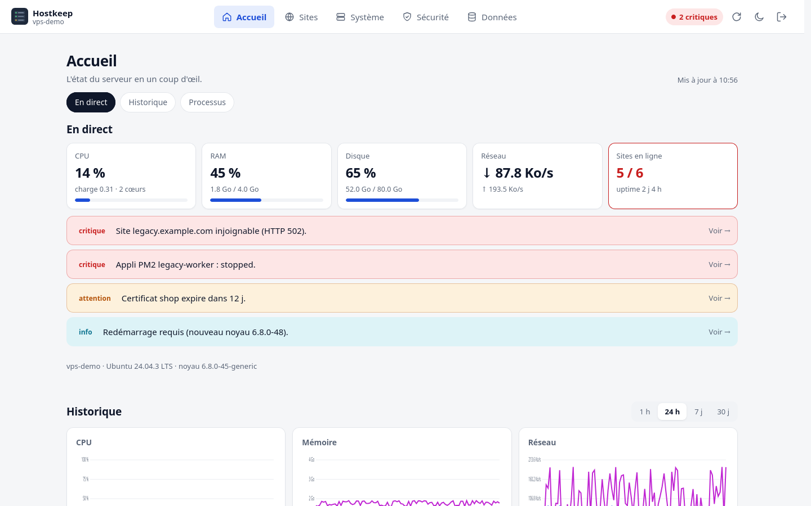
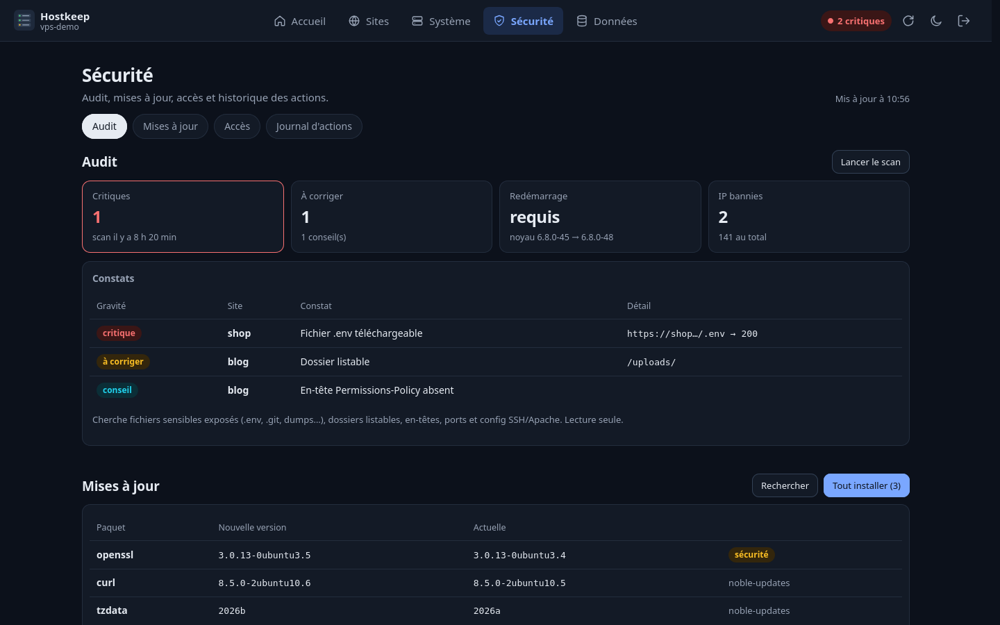
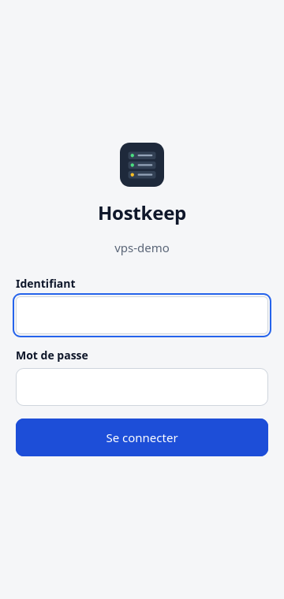
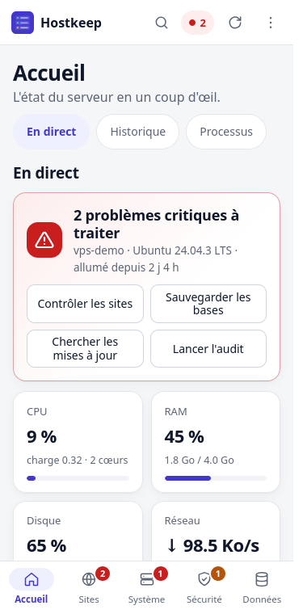
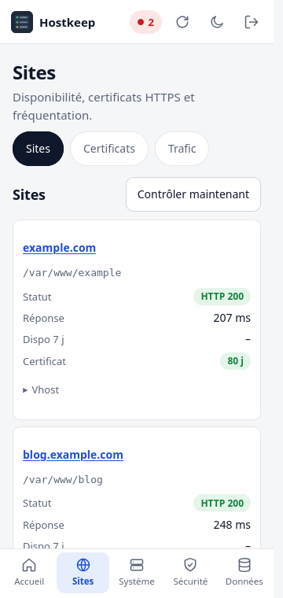
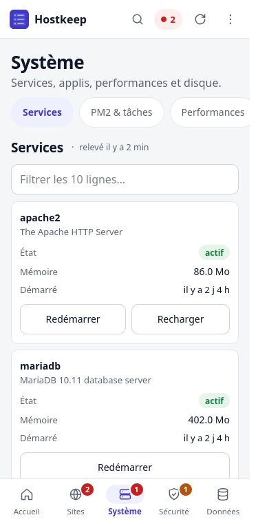
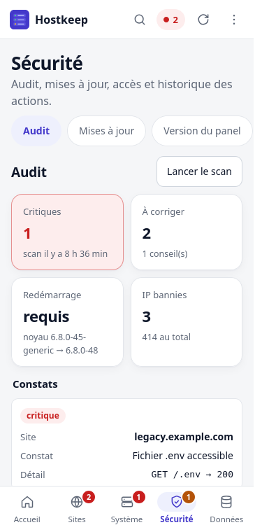
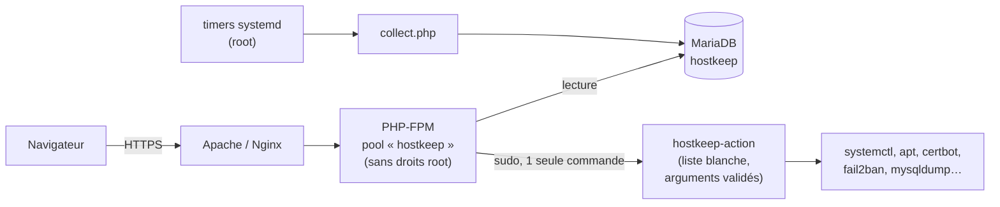

# Hostkeep

**Le panel d'administration léger pour garder un œil (et la main) sur ton VPS Linux, depuis un navigateur ou un téléphone.**


Hostkeep réunit sur 5 pages tout ce qu'on va chercher en SSH au quotidien : charge du serveur, sites en ligne,
certificats, services, sauvegardes, mises à jour, sécurité, journaux. Il permet aussi d'agir (redémarrer un service,
renouveler un certificat, restaurer une base…) sans jamais ouvrir de shell root au navigateur.

## Captures d'écran

| Bureau | Bureau, thème sombre |
|---|---|
|  |  |

| Connexion | Accueil | Sites | Système | Sécurité |
|---|---|---|---|---|
|  |  |  |  |  |

Les maquettes de la version mobile sont dans [`docs/mockups/`](docs/mockups/index.html) (HTML/CSS statique, à ouvrir dans un navigateur).

## Fonctionnalités

| Page | Contenu | Actions possibles |
|---|---|---|
| **Accueil** | CPU, RAM, disque, réseau en direct, alertes cliquables, historique 1 h → 30 j, processus les plus gourmands | — |
| **Sites** | Vhosts Apache, code HTTP et temps de réponse, disponibilité sur 7 j, certificats Let's Encrypt, trafic (visiteurs, robots, 404/5xx, pages, référents) | Contrôler les sites, activer/désactiver un vhost, tester/renouveler les certificats |
| **Système** | Services systemd, applis PM2, timers et crontabs, pools PHP-FPM, requêtes MariaDB lentes, partitions et gros dossiers | Restart/reload d'un service, restart PM2, vider le cache apt, réduire le journal |
| **Sécurité** | Audit des sites (fichiers `.env`/`.git`/dumps exposés, dossiers listables, en-têtes, ports, SSH), mises à jour apt, fail2ban, ports en écoute, connexions SSH, journal des actions | Lancer l'audit, installer les mises à jour, débannir une IP |
| **Données** | Bases MariaDB, sauvegardes quotidiennes, journaux filtrables, explorateur de fichiers en lecture seule | Sauvegarder, télécharger, restaurer une base (avec copie de sécurité automatique) |

Et aussi : application installable sur téléphone et ordinateur (PWA, page hors ligne), thème clair/sombre, interface mobile-first (barre d'onglets, zones tactiles de 44 px), rafraîchissement en direct, liens profonds (`#system/storage`), accessibilité clavier.

## Stack technique

- **Back-end :** PHP 8.1+ natif (sans framework), PHP-FPM dans un pool dédié
- **Front-end :** JavaScript vanilla, graphiques SVG faits maison, CSS sans préprocesseur. Aucune dépendance, aucun build
- **Données :** MariaDB, connexion par socket Unix (aucun mot de passe de base stocké)
- **Système :** timers systemd (collecte), sudo restreint à un helper bash en liste blanche, fail2ban, logrotate
- **Web :** Apache 2.4 ou Nginx, HTTPS Let's Encrypt (certbot)



## Prérequis

- Un VPS sous **Debian 12 / 13** ou **Ubuntu 22.04 / 24.04** (avec systemd), accès SSH avec un compte `sudo`
- Un **nom de domaine** (ou sous-domaine, ex. `admin.mondomaine.fr`) avec un enregistrement DNS `A` (et `AAAA` si IPv6) qui pointe vers le VPS
- Les ports **80 et 443** ouverts (80 sert uniquement à la validation Let's Encrypt et à la redirection vers HTTPS)
- Installés automatiquement par `install.sh deps` : PHP ≥ 8.1 (CLI + FPM, extensions `mysql`, `curl`, `mbstring`), MariaDB ≥ 10.6, fail2ban, certbot, Python 3, sudo
- Serveur web : **Apache 2.4** (recommandé, toutes les pages fonctionnent) ou **Nginx** (les pages *Sites* et *Trafic* lisent la configuration Apache et restent vides avec Nginx seul)

Installation testée de bout en bout sur Debian 12 (PHP 8.2) et Debian 13 (PHP 8.4). Le panel tourne en production sur un VPS Debian 12 avec PHP 8.4.

## Installation pas à pas

Toutes les commandes se tapent **sur le VPS**, connecté en SSH (`ssh moncompte@ip-du-vps`).

### 1. Cloner le dépôt

```bash
sudo apt-get update && sudo apt-get install -y git
sudo git clone https://github.com/ydeloustal/HostKeep.git /opt/hostkeep
cd /opt/hostkeep
```

### 2. Installer les dépendances

```bash
sudo ./install.sh deps
```

Installe PHP-FPM, MariaDB, fail2ban, certbot et les outils nécessaires, puis démarre MariaDB et fail2ban.

### 3. Configurer les variables d'environnement

```bash
sudo cp .env.example .env
sudo nano .env
```

Renseigne au minimum `HOSTKEEP_DOMAIN` (ton sous-domaine) et, de préférence, `HOSTKEEP_LETSENCRYPT_EMAIL`.
Toutes les autres valeurs ont un défaut raisonnable : services et version de PHP sont détectés automatiquement.
Chaque variable est expliquée dans [`.env.example`](.env.example). **Ne remplis pas le mot de passe à la main** : c'est l'étape 5.

| Variable | Rôle | Défaut |
|---|---|---|
| `HOSTKEEP_DOMAIN` | Domaine du panel | *(obligatoire)* |
| `HOSTKEEP_LETSENCRYPT_EMAIL` | E-mail pour Let's Encrypt | vide |
| `HOSTKEEP_ADMIN_USER` | Identifiant de connexion | `admin` |
| `HOSTKEEP_PASSWORD_HASH` | Hash bcrypt, écrit par `set-password.php` | vide |
| `HOSTKEEP_SESSION_TIMEOUT` | Déconnexion après inactivité (s) | `1800` |
| `HOSTKEEP_PHP_VERSION` | Version de PHP-FPM | celle de `php` |
| `HOSTKEEP_SERVICES` | Services affichés / redémarrables | détection auto |
| `HOSTKEEP_FILE_ROOTS` | Dossiers de l'explorateur | `/var/www /etc/apache2 …` |

### 4. Lancer en production

```bash
sudo ./install.sh app
```

Ce que fait cette commande (idempotente, relançable sans risque) :

- crée l'utilisateur système `hostkeep` (sans shell ni dossier personnel) ;
- copie l'application dans `/var/www/hostkeep` et le `.env` en `root:hostkeep 640` ;
- crée la base `hostkeep` (accès par socket Unix, droits minimaux) ;
- installe le helper root `/usr/local/sbin/hostkeep-action` et la règle sudo qui n'autorise que lui ;
- crée un pool PHP-FPM dédié, confiné par `open_basedir` ;
- active la jail fail2ban `hostkeep` (5 échecs de connexion → bannissement 1 h) ;
- active les **timers systemd** de collecte : chaque minute (métriques), 5 min (sites, certificats, sécurité), heure (stockage, mises à jour), et chaque nuit (sauvegarde des bases, audit, purge).

Définis ensuite ton identifiant et ton mot de passe (12 caractères minimum) :

```bash
sudo php /var/www/hostkeep/bin/set-password.php
```

> **Pourquoi pas Docker ?** Hostkeep pilote l'hôte lui-même (systemctl, apt, fail2ban, certbot, vhosts). Dans un conteneur, il
> faudrait le lancer en mode privilégié avec le système de fichiers de l'hôte monté, ce qui annulerait tout le modèle de sécurité
> (sudo limité à une liste blanche). L'installation native avec systemd est donc le mode de production recommandé.

### 5. Reverse proxy et HTTPS (Let's Encrypt)

Choisis **un** des deux serveurs web. La commande installe le serveur s'il manque, publie le panel en HTTP, obtient le certificat
Let's Encrypt (méthode webroot), puis active le HTTPS avec redirection automatique.

**Apache** (recommandé) :

```bash
sudo ./install.sh apache
```

**Nginx** :

```bash
sudo ./install.sh nginx
```

Le renouvellement est automatique (timer `certbot.timer`) et recharge le serveur web après chaque renouvellement.
Les fichiers générés sont `/etc/apache2/sites-available/hostkeep*.conf` ou `/etc/nginx/sites-available/hostkeep.conf` ;
les modèles sont dans [`system/`](system/).

Ouvre ensuite `https://ton-domaine` et connecte-toi. 🎉

## Sécurité

Le panel a des pouvoirs d'administration : protège-le comme un accès SSH.

- **Identifiants :** il n'y a **aucun mot de passe par défaut**, la connexion est impossible tant que `set-password.php` n'a pas été lancé. Choisis un identifiant autre que `admin` et un mot de passe long et unique. Relance le même script pour le changer.
- **Toujours en HTTPS :** n'expose jamais le panel en HTTP simple. Le cookie de session est `Secure`, donc la connexion ne fonctionne de toute façon qu'en HTTPS.
- **Pare-feu :** n'ouvre que le nécessaire, par exemple avec `ufw` :

  ```bash
  sudo apt-get install -y ufw
  sudo ufw allow OpenSSH
  sudo ufw allow 80,443/tcp
  sudo ufw enable
  ```

- **Restreindre par IP** (fortement conseillé si ton IP est fixe ou si tu passes par un VPN) :
  - Apache : dans `/etc/apache2/sites-available/hostkeep-le-ssl.conf`, remplace `Require all granted` par `Require ip 203.0.113.10` (ton IP), puis `sudo systemctl reload apache2` ;
  - Nginx : dans le bloc `server { listen 443 … }` de `/etc/nginx/sites-available/hostkeep.conf`, ajoute `allow 203.0.113.10;` puis `deny all;`, puis `sudo systemctl reload nginx`.

  Attention : relancer `install.sh apache|nginx` régénère ces fichiers, il faudra alors refaire la modification.
- **Ce qui est déjà en place :** session expirée après 30 min d'inactivité, protection CSRF, CSP stricte, `X-Frame-Options: DENY`, limite de 5 essais / 15 min par IP + fail2ban, page web exécutée sans droits root, actions limitées à une liste blanche avec arguments revalidés côté root, journal de toutes les actions, explorateur de fichiers en lecture seule (clés privées toujours refusées).
- **Secrets :** le `.env` (qui contient le hash du mot de passe) est hors de la racine web, lisible seulement par root et le groupe `hostkeep`. Il est ignoré par Git : ne le commite jamais.

## Mise à jour

**Depuis le panel :** page *Sécurité › Version du panel*, bouton **Mettre à jour**. Le helper root fait un `git pull`
(avance rapide uniquement) dans le clone qui a servi à l'installation, puis relance `./install.sh app`. Le panel vérifie
chaque heure s'il y a des nouveautés sur GitHub et l'affiche dans les alertes. Le bouton refuse de travailler si le clone
n'appartient pas à root ou si des fichiers y ont été modifiés à la main.

**En SSH :**

```bash
cd /opt/hostkeep
sudo git pull
sudo ./install.sh app
```

Le code est remplacé, le `.env` installé (et donc ton mot de passe), la base et les sauvegardes sont conservés.
Si une nouvelle version modifie les modèles de serveur web, relance aussi `sudo ./install.sh apache` (ou `nginx`).

## Désinstallation

```bash
cd /opt/hostkeep
sudo ./install.sh uninstall           # retire le panel, garde la base, les sauvegardes et /var/www/hostkeep
sudo ./install.sh uninstall --purge   # supprime aussi la base, les sauvegardes, les logs et l'utilisateur
```

Le certificat Let's Encrypt est conservé ; pour le supprimer : `sudo certbot delete --cert-name ton-domaine`.
Le fichier `/etc/apache2/conf-available/hardening.conf` (qui bloque le téléchargement de `.env`, `.git`, dumps… sur tous les sites) est volontairement gardé.

## Dépannage

| Symptôme | Cause probable | Solution |
|---|---|---|
| `pas de certificat` pendant `install.sh apache/nginx` | Le DNS ne pointe pas (encore) vers le VPS, ou le port 80 est fermé | Vérifie `dig +short ton-domaine`, ouvre le port 80 (`sudo ufw allow 80/tcp`), attends la propagation DNS puis relance |
| « Aucun mot de passe défini » sur la page de connexion | `set-password.php` n'a pas été lancé | `sudo php /var/www/hostkeep/bin/set-password.php` |
| « Trop de tentatives » ou page inaccessible depuis ton IP | Limite de connexion ou bannissement fail2ban | Attends 15 min, ou `sudo fail2ban-client set hostkeep unbanip TON_IP` |
| Erreur 502 / 503 | Pool PHP-FPM arrêté ou mauvaise version de PHP | `sudo systemctl status php8.X-fpm`, vérifie `HOSTKEEP_PHP_VERSION`, relance `sudo ./install.sh app` |
| Alerte « Le collecteur ne remonte plus de mesures » | Timers arrêtés ou erreur de collecte | `systemctl list-timers 'hostkeep-*'` et `journalctl -u 'hostkeep-collect@*' -n 50` |
| « Refusé : service non autorisé » | Le service n'est pas installé ou pas dans `HOSTKEEP_SERVICES` | Ajoute-le à `HOSTKEEP_SERVICES` dans `/var/www/hostkeep/.env` |
| Pages *Sites* et *Trafic* vides | Le serveur web est Nginx (ces pages lisent Apache) | Comportement normal avec Nginx seul |
| « Session expirée, réessaie » à la connexion | Cookie bloqué ou accès en HTTP | Ouvre bien l'adresse en `https://` |

Les journaux utiles : `/var/log/hostkeep/` (connexions, erreurs PHP), `journalctl -u 'hostkeep-collect@*'` (collecte),
et ceux du serveur web (`/var/log/apache2/hostkeep-error.log` ou `/var/log/nginx/hostkeep-error.log`).

## Structure du dépôt

```
app/
  public/       pages servies (index, login, API JSON) et assets (JS, CSS)
  src/          configuration, authentification, actions, collecteurs
  bin/          collecteur (root), schéma SQL, définition du mot de passe
system/         helper root, sudoers, pool PHP-FPM, vhosts Apache, Nginx, timers systemd, fail2ban, logrotate
docs/           maquettes mobiles et captures d'écran
install.sh      installateur (deps, app, apache, nginx, uninstall)
.env.example    configuration commentée
```

## Licence et auteur

Distribué sous licence [MIT](LICENSE). Conçu et développé par **Yoan**.
