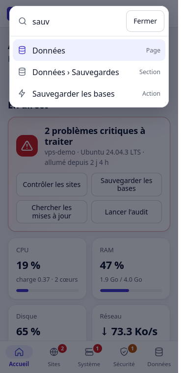
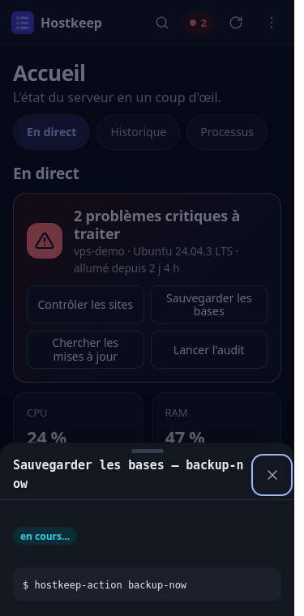
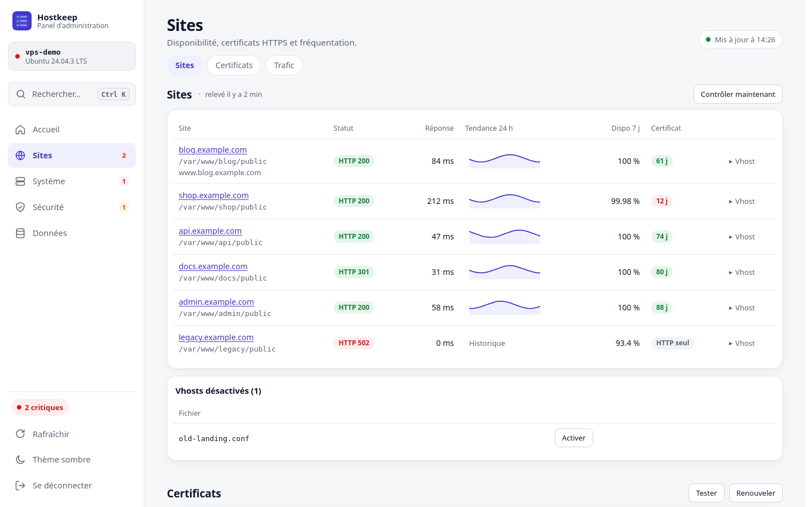
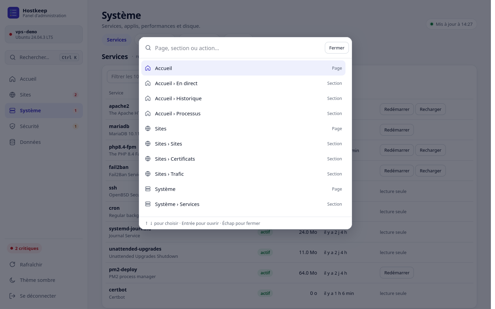
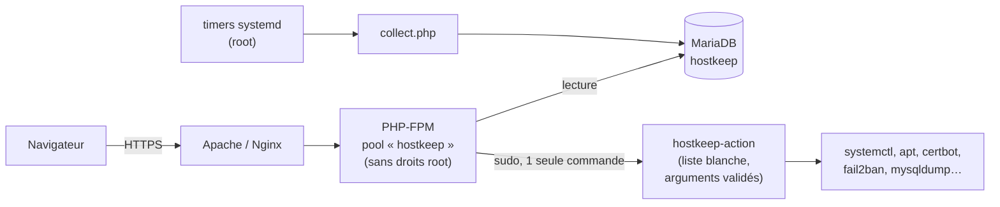

<p align="center">
  
</p>

<h1 align="center">Hostkeep</h1>

<p align="center">
  <strong>Ton VPS Linux dans la poche.</strong><br>
  Un panel d'administration léger pour surveiller ton serveur et agir dessus,<br>
  depuis un navigateur ou un téléphone, sans jamais ouvrir de shell root au web.
</p>

<p align="center">
  
  
  
  
  
  
</p>

<p align="center">
  <a href="#-installation-en-5-minutes">Installation</a> ·
  <a href="#-ce-que-tu-peux-faire">Fonctionnalités</a> ·
  <a href="#-sécurité">Sécurité</a> ·
  <a href="#-mise-à-jour">Mise à jour</a> ·
  <a href="#-dépannage">Dépannage</a>
</p>


## ✨ Pourquoi Hostkeep ?

- **Tout au même endroit.** Charge du serveur, sites, certificats, services, sauvegardes, mises à jour, sécurité et journaux : ce qu'on va chercher en SSH tous les jours, réuni sur 5 pages.
- **Pensé pour le téléphone.** Barre d'onglets en bas, boutons de 44 px, tableaux affichés en cartes, application installable (PWA).
- **On agit, pas seulement on regarde.** Redémarrer un service, renouveler un certificat, restaurer une base, installer les mises à jour : un bouton, une confirmation, le résultat en direct.
- **Sûr par construction.** La page web tourne sans droits root. Les actions passent par un seul script en liste blanche, chaque argument est revalidé, tout est journalisé.
- **Rien à compiler.** PHP natif, JavaScript vanilla, aucune dépendance front, aucun build.

## 📸 Aperçu

| Accueil | Recherche | Sites | Sécurité | Action en cours |
|---|---|---|---|---|
|  |  |  |  |  |

<details>
<summary><strong>Voir la version ordinateur et le thème sombre</strong></summary>

| Sites | Sécurité, thème sombre |
|---|---|
|  |  |

| Recherche et commandes (Ctrl K) | Connexion |
|---|---|
|  |  |

</details>

## 🧭 Ce que tu peux faire

| Page | Tu vois | Tu peux |
|---|---|---|
| **Accueil** | L'état général en une phrase, les alertes triées par gravité, CPU / RAM / disque / réseau en direct, l'historique de 1 h à 30 j, les processus gourmands | Lancer les contrôles courants en un geste : sites, sauvegarde, mises à jour, audit |
| **Sites** | Vhosts Apache, code HTTP, temps de réponse, disponibilité sur 7 j, certificats Let's Encrypt, trafic (visiteurs, robots, 404/5xx, pages, référents) | Contrôler les sites, activer ou désactiver un vhost, tester et renouveler les certificats |
| **Système** | Services systemd, applis PM2, timers et crontabs, pools PHP-FPM, requêtes MariaDB lentes, partitions et gros dossiers | Redémarrer ou recharger un service, redémarrer une appli PM2, vider le cache apt, réduire le journal |
| **Sécurité** | Audit des sites (`.env`, `.git`, dumps exposés, dossiers listables, en-têtes, ports, SSH), mises à jour apt, fail2ban, ports ouverts, connexions SSH, journal des actions | Lancer l'audit, installer les mises à jour, débannir une IP, mettre à jour le panel |
| **Données** | Bases MariaDB, sauvegardes quotidiennes, journaux filtrables, explorateur de fichiers en lecture seule | Sauvegarder, télécharger, restaurer une base (copie de sécurité automatique avant) |

### Une interface faite pour aller vite

| | |
|---|---|
| 🔎 **Recherche universelle** | `Ctrl K` (ou `/`, ou la loupe sur mobile) : tape « ssl », « disque » ou « sauvegarde » pour ouvrir la bonne section ou lancer une action. |
| ⌨️ **Raccourcis clavier** | `1` à `5` pour changer de page, `R` pour rafraîchir, `?` pour la liste. |
| 🧹 **Filtres instantanés** | Chaque tableau de plus de 8 lignes a son champ de filtre. |
| 🔔 **Actions en arrière-plan** | Ferme la fenêtre d'une action longue : elle continue, une notification t'annonce le résultat. |
| 📱 **Installable** | Sur téléphone et ordinateur (PWA), avec une page claire quand le serveur est injoignable. |
| 🌗 **Clair et sombre** | Suit le système, modifiable d'un clic. |
| ♿ **Accessible** | Navigation complète au clavier, contrastes AA, animations coupées si le système le demande. |
| 🔗 **Liens profonds** | Chaque section a son adresse, par exemple `#system/storage`. |

## 🚀 Installation en 5 minutes

**Il te faut :**

- un VPS **Debian 12 / 13** ou **Ubuntu 22.04 / 24.04** avec un compte `sudo` ;
- un **sous-domaine** (ex. `admin.mondomaine.fr`) dont l'enregistrement DNS `A` pointe vers le VPS ;
- les ports **80 et 443** ouverts.

Toutes les commandes se tapent **sur le VPS**, en SSH.

**1. Récupérer le code**

```bash
sudo apt-get update && sudo apt-get install -y git
sudo git clone https://github.com/ydeloustal/HostKeep.git /opt/hostkeep
cd /opt/hostkeep
```

**2. Installer les dépendances** (PHP-FPM, MariaDB, fail2ban, certbot)

```bash
sudo ./install.sh deps
```

**3. Configurer** : renseigne au minimum `HOSTKEEP_DOMAIN`, et de préférence `HOSTKEEP_LETSENCRYPT_EMAIL`

```bash
sudo cp .env.example .env
sudo nano .env
```

**4. Installer l'application**

```bash
sudo ./install.sh app
```

**5. Choisir ton identifiant et ton mot de passe** (12 caractères minimum)

```bash
sudo php /var/www/hostkeep/bin/set-password.php
```

**6. Publier en HTTPS** : choisis **un** serveur web

```bash
sudo ./install.sh apache   # recommandé : toutes les pages fonctionnent
```

```bash
sudo ./install.sh nginx    # les pages Sites et Trafic restent vides (elles lisent Apache)
```

Ouvre `https://ton-domaine` et connecte-toi. 🎉

<details>
<summary><strong>Toutes les variables du <code>.env</code></strong></summary>

Chaque variable est expliquée dans [`.env.example`](.env.example). **Ne remplis pas le mot de passe à la main** : c'est le rôle de `set-password.php`.

| Variable | Rôle | Défaut |
|---|---|---|
| `HOSTKEEP_DOMAIN` | Domaine du panel | *(obligatoire)* |
| `HOSTKEEP_LETSENCRYPT_EMAIL` | E-mail pour Let's Encrypt | vide |
| `HOSTKEEP_ADMIN_USER` | Identifiant de connexion | `admin` |
| `HOSTKEEP_PASSWORD_HASH` | Hash bcrypt, écrit par `set-password.php` | vide |
| `HOSTKEEP_SESSION_TIMEOUT` | Déconnexion après inactivité (s) | `1800` |
| `HOSTKEEP_PHP_VERSION` | Version de PHP-FPM | celle de `php` |
| `HOSTKEEP_SERVICES` | Services affichés / redémarrables | détection auto |
| `HOSTKEEP_FILE_ROOTS` | Dossiers de l'explorateur | `/var/www /etc/apache2 …` |

</details>

<details>
<summary><strong>Ce que fait exactement <code>install.sh app</code></strong></summary>

La commande est idempotente : tu peux la relancer sans risque.

- crée l'utilisateur système `hostkeep` (sans shell ni dossier personnel) ;
- copie l'application dans `/var/www/hostkeep` et le `.env` en `root:hostkeep 640` ;
- crée la base `hostkeep` (accès par socket Unix, droits minimaux) ;
- installe le helper root `/usr/local/sbin/hostkeep-action` et la règle sudo qui n'autorise que lui ;
- crée un pool PHP-FPM dédié, confiné par `open_basedir` ;
- active la jail fail2ban `hostkeep` (5 échecs de connexion → bannissement 1 h) ;
- active les **timers systemd** de collecte : chaque minute (métriques), 5 min (sites, certificats, sécurité), chaque heure (stockage, mises à jour) et chaque nuit (sauvegarde des bases, audit, purge).

</details>

<details>
<summary><strong>HTTPS et serveur web, en détail</strong></summary>

`install.sh apache` ou `install.sh nginx` installe le serveur s'il manque, publie le panel en HTTP, obtient le certificat Let's Encrypt (méthode webroot), puis active le HTTPS avec redirection automatique.

Le renouvellement est automatique (timer `certbot.timer`) et recharge le serveur web après chaque renouvellement. Les fichiers générés sont `/etc/apache2/sites-available/hostkeep*.conf` ou `/etc/nginx/sites-available/hostkeep.conf` ; les modèles sont dans [`system/`](system/).

Installation testée de bout en bout sur Debian 12 (PHP 8.2) et Debian 13 (PHP 8.4). Les prérequis logiciels (PHP ≥ 8.1 avec `mysql`, `curl`, `mbstring`, MariaDB ≥ 10.6, fail2ban, certbot, Python 3, sudo) sont installés par `install.sh deps`.

</details>

<details>
<summary><strong>Pourquoi pas Docker ?</strong></summary>

Hostkeep pilote l'hôte lui-même (systemctl, apt, fail2ban, certbot, vhosts). Dans un conteneur, il faudrait le lancer en mode privilégié avec le système de fichiers de l'hôte monté, ce qui annulerait tout le modèle de sécurité (sudo limité à une liste blanche). L'installation native avec systemd est donc le mode de production recommandé.

</details>

## 🏗️ Comment ça marche



| Couche | Choix |
|---|---|
| **Back-end** | PHP 8.1+ natif (sans framework), PHP-FPM dans un pool dédié |
| **Front-end** | JavaScript vanilla, graphiques SVG faits maison, CSS sans préprocesseur |
| **Données** | MariaDB par socket Unix : aucun mot de passe de base stocké |
| **Système** | Timers systemd pour la collecte, sudo restreint à un helper bash, fail2ban, logrotate |
| **Web** | Apache 2.4 ou Nginx, HTTPS Let's Encrypt (certbot) |

## 🔒 Sécurité

Le panel a des pouvoirs d'administration : **protège-le comme un accès SSH.**

**Déjà en place**

- Aucun mot de passe par défaut : la connexion est impossible tant que `set-password.php` n'a pas été lancé.
- Page web exécutée **sans droits root**, actions limitées à une liste blanche, arguments revalidés côté root.
- Session expirée après 30 min d'inactivité, cookie `Secure`, protection CSRF, CSP stricte, `X-Frame-Options: DENY`.
- 5 essais par 15 min et par IP, puis bannissement fail2ban.
- Journal de toutes les actions. Explorateur de fichiers en lecture seule, clés privées toujours refusées.
- `.env` hors de la racine web, lisible seulement par root et le groupe `hostkeep`, ignoré par Git.

**À faire de ton côté**

1. Choisis un identifiant autre que `admin` et un mot de passe long et unique (relance `set-password.php` pour le changer).
2. N'expose jamais le panel en HTTP simple.
3. Ferme tout ce qui n'est pas nécessaire :

   ```bash
   sudo apt-get install -y ufw
   sudo ufw allow OpenSSH
   sudo ufw allow 80,443/tcp
   sudo ufw enable
   ```

4. Si ton IP est fixe ou si tu passes par un VPN, **restreins l'accès par IP** :
   - **Apache** : dans `/etc/apache2/sites-available/hostkeep-le-ssl.conf`, remplace `Require all granted` par `Require ip 203.0.113.10`, puis `sudo systemctl reload apache2` ;
   - **Nginx** : dans le bloc `server { listen 443 … }` de `/etc/nginx/sites-available/hostkeep.conf`, ajoute `allow 203.0.113.10;` puis `deny all;`, puis `sudo systemctl reload nginx`.

   Relancer `install.sh apache|nginx` régénère ces fichiers : il faudra refaire la modification.

## 🔄 Mise à jour

**Depuis le panel :** *Sécurité › Version du panel*, bouton **Mettre à jour**. Le panel vérifie chaque heure s'il y a des nouveautés sur GitHub et l'affiche dans les alertes. Un bouton **Revenir à…** réinstalle la version précédente. La mise à jour est refusée si le clone n'appartient pas à root ou si des fichiers y ont été modifiés à la main.

**En SSH :**

```bash
cd /opt/hostkeep
sudo git pull
sudo ./install.sh app
```

Le code est remplacé ; le `.env` (donc ton mot de passe), la base et les sauvegardes sont conservés. Si une version modifie les modèles de serveur web, relance aussi `sudo ./install.sh apache` (ou `nginx`).

## 🗑️ Désinstallation

```bash
cd /opt/hostkeep
sudo ./install.sh uninstall           # retire le panel, garde la base, les sauvegardes et /var/www/hostkeep
sudo ./install.sh uninstall --purge   # supprime aussi la base, les sauvegardes, les logs et l'utilisateur
```

Le certificat Let's Encrypt est conservé ; pour le supprimer : `sudo certbot delete --cert-name ton-domaine`. Le fichier `/etc/apache2/conf-available/hardening.conf` (qui bloque le téléchargement de `.env`, `.git`, dumps… sur tous les sites) est volontairement gardé.

## 🩺 Dépannage

| Symptôme | Cause probable | Solution |
|---|---|---|
| `pas de certificat` pendant `install.sh apache/nginx` | Le DNS ne pointe pas (encore) vers le VPS, ou le port 80 est fermé | Vérifie `dig +short ton-domaine`, ouvre le port 80 (`sudo ufw allow 80/tcp`), attends la propagation DNS puis relance |
| « Aucun mot de passe défini » à la connexion | `set-password.php` n'a pas été lancé | `sudo php /var/www/hostkeep/bin/set-password.php` |
| « Trop de tentatives » ou page inaccessible depuis ton IP | Limite de connexion ou bannissement fail2ban | Attends 15 min, ou `sudo fail2ban-client set hostkeep unbanip TON_IP` |
| Erreur 502 / 503 | Pool PHP-FPM arrêté ou mauvaise version de PHP | `sudo systemctl status php8.X-fpm`, vérifie `HOSTKEEP_PHP_VERSION`, relance `sudo ./install.sh app` |
| Alerte « Le collecteur ne remonte plus de mesures » | Timers arrêtés ou erreur de collecte | `systemctl list-timers 'hostkeep-*'` et `journalctl -u 'hostkeep-collect@*' -n 50` |
| « Refusé : service non autorisé » | Le service n'est pas installé ou pas dans `HOSTKEEP_SERVICES` | Ajoute-le à `HOSTKEEP_SERVICES` dans `/var/www/hostkeep/.env` |
| Pages *Sites* et *Trafic* vides | Le serveur web est Nginx (ces pages lisent Apache) | Comportement normal avec Nginx seul |
| « Session expirée, réessaie » à la connexion | Cookie bloqué ou accès en HTTP | Ouvre bien l'adresse en `https://` |
| Bandeau « Connexion au serveur perdue » | Réseau coupé ou serveur arrêté | Le panel réessaie tout seul ; si ça dure, vérifie en SSH ou chez ton hébergeur |

**Où regarder :** `/var/log/hostkeep/` (connexions, erreurs PHP), `journalctl -u 'hostkeep-collect@*'` (collecte), et les journaux du serveur web (`/var/log/apache2/hostkeep-error.log` ou `/var/log/nginx/hostkeep-error.log`).

## 📁 Structure du dépôt

```
app/
  public/       pages servies (index, login, API JSON) et assets (JS, CSS)
  src/          configuration, authentification, actions, collecteurs
  bin/          collecteur (root), schéma SQL, définition du mot de passe
system/         helper root, sudoers, pool PHP-FPM, vhosts Apache, Nginx, timers systemd, fail2ban, logrotate
docs/           captures d'écran et maquettes d'étude (docs/mockups)
install.sh      installateur (deps, app, apache, nginx, uninstall)
.env.example    configuration commentée
```

L'historique des versions est dans [`CHANGELOG.md`](CHANGELOG.md).

## 📄 Licence et auteur

Distribué sous licence [MIT](LICENSE). Conçu et développé par **Yoan**.
