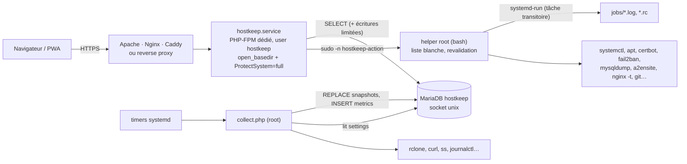

# Audit technique de l'existant

> **Version auditée :** 2.9.0, branche `develop`, commit `1b34003` (22/11/2026).
> **Méthode :** lecture du code source (statique), sans exécution sur un serveur réel. Chaque constat indique sa nature :
> **[Vérifié]** lu dans le code, **[Hypothèse]** déduit mais non reproduit, **[Recommandation]**.
> **Limites :** aucun test d'installation réel, aucun test d'intrusion dynamique, aucune mesure de performance sur machine. Ces points sont listés en fin de document comme « à confirmer ».

---

## 1. Synthèse

Hostkeep est aujourd'hui un **panel d'administration mono-serveur**, natif (PHP 8.1+, MariaDB, Bash, systemd), **mobile-first**, construit autour d'un modèle de sécurité net : l'application web tourne sans privilège et ne peut déclencher que des **actions en liste blanche** exécutées par un **helper root** qui revalide chaque argument. La qualité du code est homogène, commentée, défensive, et le périmètre fonctionnel est déjà large pour un projet de 10 jours (v1.0.0 le 12/11/2026, v2.9.0 le 21/11/2026, 103 commits).

| Dimension | Évaluation | Commentaire |
|---|---|---|
| Modèle de sécurité | **Bon**, avec 2 brèches de frontière | Helper en liste blanche, DB par socket sans mot de passe, privilèges SQL minimaux, CSP stricte. Mais le collecteur root lit des réglages écrits par le web (rclone), et la frontière Admin/Super Admin est poreuse. |
| Couverture fonctionnelle | **Moyenne** (surveillance forte, administration faible) | Beaucoup d'observation, peu de gestion : pas de pare-feu, d'utilisateurs Linux, de Docker, de création de site/base, d'édition de fichiers. |
| Architecture | **Saine mais mono-serveur et monolithique** | Tout suppose « ce serveur » : chemins, snapshots, métriques, actions. Routeur API unique, `app.js` de 1 575 lignes. |
| Tests | **Quasi absents** | CI = lint (PHP, shellcheck, JS, JSON, sudoers) + idempotence du schéma. Aucun test unitaire, d'intégration, E2E ou de sécurité. |
| Documentation | **Bonne côté utilisateur**, absente côté contributeur | README très complet, CHANGELOG tenu. Pas d'architecture, de guide de contribution, de `SECURITY.md`, ni de doc d'API. |
| Maintenabilité | **Correcte aujourd'hui, à risque demain** | Pas de dépendances, pas de build : excellent pour l'installation. Mais chaînes françaises en dur partout, permissions dupliquées front/back, migrations non versionnées. |
| Performance | **Très légère** | PHP-FPM `ondemand` (0 processus au repos, 5 max, 64 Mo), graphiques SVG maison, polling suspendu en arrière-plan. Collecte séquentielle qui ne passera pas à l'échelle (voir §6). |

---

## 2. Inventaire du dépôt

104 fichiers suivis, ~11 500 lignes (hors images).

| Zone | Fichiers principaux | Lignes | Rôle |
|---|---|---:|---|
| Front | `app/public/assets/app.js`, `app.css`, `login.js`, `sw.js`, `manifest.json` | ~2 270 | SPA vanilla, rendu par `el()` / `textContent`, PWA |
| Pages PHP | `app/public/{index,login,2fa,password,logout,api}.php` | ~950 | Pages serveur + routeur JSON `api.php?r=…` |
| Domaine | `app/src/*.php` (16 fichiers) | ~4 300 | Auth, RBAC, TOTP, réglages, notifications, sauvegardes, serveurs web, audit, migration |
| Collecteur | `app/bin/collect.php` (+ `collect_extra.php`, `offsite.php`, `webservers.php`) | ~2 000 | Exécuté **en root** par timers systemd |
| CLI | `app/bin/user.php`, `set-password.php`, `system/hostkeep-cli` | ~420 | Gestion des comptes, commande `hostkeep` |
| Helper root | `system/hostkeep-action` | 441 | Seul point d'entrée `sudo` : liste blanche d'actions |
| Installation | `install.sh`, `system/restore.sh` | ~1 180 | Installation idempotente, publication web, rollback, migration |
| Système | `system/systemd/*`, sudoers, fail2ban, logrotate, php-fpm, hardening | ~350 | Unités, timers, durcissement |
| Docs | `README.md`, `CHANGELOG.md`, `docs/RESTORE.md`, maquettes, captures | ~650 | Documentation utilisateur |
| CI | `.github/workflows/ci.yml` | 56 | Lint + schéma |

**Hors dépôt, dans la copie de travail :**
- `admin-dashboard/` (non suivi) : **ancienne version** du projet (nommée « dashboard »), avec cron au lieu de timers, mono-compte. Elle contient le nom d'hôte d'un serveur réel dans son README. **[Recommandation]** ne jamais la committer ; l'archiver hors du dépôt ou l'ajouter au `.gitignore`. (Non supprimée, conformément aux consignes.)
- `.claude/mock.py` + `launch.json` (ignorés par Git) : serveur de démo Python qui sert `app/public` avec de fausses données. Utile pour développer le front sans serveur ; **[Recommandation]** le versionner dans `tools/` car c'est le seul moyen de faire tourner l'interface localement.

---

## 3. Architecture actuelle

**Flux de données [Vérifié] :**
1. **Lecture** : le collecteur root écrit des « snapshots » JSON par section (`services`, `sites`, `security`…) dans la table `snapshots` ; l'API web ne fait que les relire (`api.php?r=section&name=…`). Le web n'exécute presque aucune commande système en lecture (seulement `/proc` pour le direct).
2. **Action** : `POST api.php?r=action {verb,args}` → vérification RBAC (`ACTION_PERMS`) → validation regex (`ACTIONS`) → `sudo hostkeep-action job <verb> <args>` → revalidation Bash → `systemd-run` → sortie dans `/var/lib/hostkeep/jobs/<id>.log`, sondée par le front.
3. **Sauvegardes, notifications, ping externe** : exécutés par le collecteur root selon les réglages stockés en base.

**Points forts de conception [Vérifié]**
- Pas de shell côté web : `proc_open` avec tableau d'arguments, jamais de chaîne interprétée.
- Double validation (PHP puis Bash), et valeurs dynamiques vérifiées contre l'état réel (service autorisé, jail existante, app PM2 existante, vhost existant, IP valide via `ipaddress`).
- Tâches détachées dans une unité systemd transitoire : un redémarrage de PHP-FPM ne tue pas une action en cours.
- Comptes SQL : le web n'a que `SELECT` partout, et des écritures uniquement sur les tables qui le nécessitent (`users`, `user_sessions`, `settings`, `audit_log`, `login_attempts`, `password_resets`, `user_recovery_codes`). Il ne peut pas écrire `snapshots` ni `metrics`.
- Publication web avec test de syntaxe et retour arrière automatique dans `install.sh` et dans le helper.

**Limites structurelles [Vérifié]**
- **Mono-serveur par construction** : `db()` se connecte au socket local, les chemins (`/var/backups/hostkeep`, `/etc/nginx`…) sont des constantes, les tables n'ont pas de colonne `server_id`, les actions s'exécutent localement.
- **Monolithe de routage** : `api.php` = un `switch` de ~35 routes ; `app.js` = un fichier de 1 575 lignes.
- **Liste blanche définie 3 fois** : `ACTIONS` (PHP), `ACTION_PERMS` (PHP), `VERB_PERMS` (JS) et `validate()` (Bash). Toute nouvelle action impose 4 modifications cohérentes.
- **État des tâches dans des fichiers** (`jobs/*.log|.rc`) et non en base : pas d'historique interrogeable, pas de file d'attente, pas de priorité, pas de reprise.

---

## 4. État réel des fonctionnalités

Légende : ✅ Fonctionnelle et complète · 🟡 Fonctionnelle mais perfectible · 🟠 Partiellement implémentée · 🔴 Présente mais défectueuse · ⚪ Absente · ⚫ Obsolète ou redondante.
« Complète » signifie : complète **pour le périmètre qu'elle revendique**, pas au regard de la vision cible.

### 4.1 Accès, comptes, sécurité du panel

| Fonctionnalité | État | Constat |
|---|:---:|---|
| Connexion identifiant / e-mail, hachage bcrypt/argon, rehash | ✅ | Temps de réponse constant (hash factice si compte inconnu). |
| Limitation des tentatives (IP + compte) + fail2ban | 🟡 | Fonctionne. En mode proxy, l'IP réelle est déduite de `X-Forwarded-For` accepté depuis **tous** les réseaux privés (§5, S5). |
| Sessions doublées en base, révocables, expiration d'inactivité | ✅ | Polling `X-Poll` ne prolonge pas la session : bon choix. |
| CSRF, cookies `Secure/HttpOnly/SameSite=Strict`, CSP stricte, HSTS | ✅ | CSP sans `unsafe-inline`. |
| TOTP (RFC 6238), codes de secours, politique par rôle, anti-rejeu | ✅ | QR code généré côté serveur sans dépendance. |
| Passkeys / WebAuthn | ⚪ | — |
| SSO (OIDC/SAML), LDAP | ⚪ | — |
| RBAC à 4 rôles fixes, vérifié serveur | 🟡 | Solide, mais rôles non personnalisables, pas de portée (par serveur, par site), et frontière Admin/Super Admin contournable (S2). |
| Gestion des comptes (création, invitation, reset, désactivation, protection du dernier Super Admin) | ✅ | |
| Mot de passe oublié par e-mail | ✅ | Jeton haché, 1 h, 1 envoi / 5 min / compte. |
| Liste d'IP autorisées | ✅ | Refuse un réglage qui exclut l'IP courante. |
| Journal d'audit | 🟠 | Présent, 300 dernières lignes, pas de filtre ni d'export ; modifiable par l'utilisateur SQL web (S6) ; **code retour non renseigné si personne ne suit la tâche** (B1). |
| Tokens d'API / API publique | ⚪ | L'API existe mais uniquement par cookie de session. |

### 4.2 Surveillance

| Fonctionnalité | État | Constat |
|---|:---:|---|
| CPU, RAM, swap, charge, réseau (agrégé), processus (direct, 5 s) | ✅ | Lus dans `/proc`. |
| Historique 1 h → 30 j | 🟡 | 1 point/min, 31 jours. **Un seul disque (`/`)**, réseau total sans détail par interface, pas de températures, pas d'I/O disque. |
| Top processus (CPU / mémoire) | 🟡 | 15 lignes par tri, rafraîchi chaque minute ; pas d'action (kill, renice). |
| Services systemd (liste, état, mémoire, redémarrages) | 🟡 | Limité à une liste détectée ou configurée dans `.env` ; pas d'activation/désactivation, pas de logs par unité. |
| Applications PM2 | 🟡 | Lecture + redémarrage. |
| Sites : découverte Apache / Nginx / Caddy, code HTTP, latence, disponibilité 7 j | 🟡 | Très bon travail de parsing. Sondes séquentielles (8 s max chacune) toutes les 5 min : ne tient pas au-delà de quelques dizaines de sites (P1). Pas de contrôle de contenu ni de sonde externe. |
| Certificats (certbot, Caddy) | ✅ | Expiration suivie, renouvellement / dry-run. |
| Trafic (visiteurs, robots, 404/5xx, pages, référents) | 🟡 | Apache et Nginx (si `access_log` commun) ; Caddy non. IP hachées : bon pour la vie privée. |
| Bases MariaDB (taille, statut global, requêtes lentes) | 🟡 | Lecture seule ; PostgreSQL, Redis, MongoDB absents. |
| Stockage (partitions, gros dossiers) + prévision de remplissage | ✅ | Régression linéaire 30 j, alertes 14 j / 3 j. |
| Timers et crontabs | 🟡 | Lecture seule. |
| Pools PHP-FPM | 🟡 | Lecture (liés aux sites). |
| Alertes (calcul) | 🟡 | 17 règles codées en dur dans `overview.php`, **non configurables** (seuils fixes). |
| Notifications (e-mail, Discord, Telegram, webhook JSON) | 🔴 | Fonctionnent, mais **dédoublonnage par texte** : une alerte dont le texte contient une valeur variable est renvoyée à chaque cycle (B2). |
| Surveillance externe (ping Healthchecks / Uptime Kuma) | ✅ | Bonne idée « dead man's switch », signal d'échec si collecte en erreur. |
| Historique des incidents | ⚪ | Les alertes sont recalculées, jamais historisées. |
| Comparaison entre serveurs, rapports périodiques | ⚪ | — |

### 4.3 Actions et administration

| Fonctionnalité | État | Constat |
|---|:---:|---|
| Redémarrer / recharger un service autorisé (avec `configtest` / `nginx -t`) | ✅ | |
| Activer / désactiver un vhost Apache / Nginx (avec retour arrière) | ✅ | Pas pour Caddy (assumé). |
| Créer / modifier un site, un vhost, un domaine | ⚪ | — |
| Certificats : renouveler, dry-run | ✅ | Émission pour un nouveau domaine : absente. |
| `apt update` / `apt upgrade` / nettoyage, redémarrage serveur (avec `update-grub`) | ✅ | Upgrade « tout ou rien » ; pas de sélection de paquets ni de fenêtre de maintenance. |
| fail2ban : lecture, débannissement | 🟡 | Pas de bannissement manuel ni de gestion des jails. |
| Corrections d'audit en un clic (en-têtes, fichiers sensibles, version masquée), réversibles | ✅ | Très bon modèle (fichier global, test, rollback, re-audit, bouton Retirer). |
| Pare-feu (UFW / nftables) | ⚪ | Seulement détecté par l'audit. |
| Utilisateurs Linux, clés SSH, configuration SSH | ⚪ | Lecture des connexions SSH acceptées uniquement. |
| Gestion des tâches planifiées | ⚪ | Lecture seule. |
| Explorateur de fichiers | 🟠 | **Lecture seule**, racines configurables, téléchargement ≤ 50 Mo, clés privées refusées par nom. Pas d'édition, d'upload, de permissions. |
| Journaux | 🟡 | `journalctl -p err`, fail2ban, auth Hostkeep, fichiers Apache/Nginx, PM2 ; pas de recherche plein texte, pas de journal par unité systemd. |
| Terminal web | ⚪ | Absence **voulue** (« jamais de shell root au web »). |
| Docker / conteneurs | ⚪ | Mode proxy détecte Traefik dans Docker, rien d'autre. |
| Bases : création, utilisateurs, droits, import | ⚪ | — |
| Node.js / Python / déploiement Git | ⚪ | PM2 en lecture/redémarrage seulement. |

### 4.4 Sauvegardes

| Fonctionnalité | État | Constat |
|---|:---:|---|
| Dump quotidien de chaque base MariaDB | ✅ | `mysqldump`, gzip, rétention réglable. |
| Archives de fichiers (`/var/www`, `/etc/{apache2,nginx,caddy,letsencrypt,hostkeep}`) | 🟡 | Complètes à chaque fois (pas d'incrémental, pas de déduplication) ; vérification d'espace préalable. |
| Manifeste avec SHA-256 | ✅ | |
| Copie externe rclone (S3, SFTP, toute config rclone), chiffrement crypt, rétention distante, reprise horaire | 🟡 | Fonctionnelle ; **configuration rclone libre exécutée en root** (S1). |
| Restauration d'une base depuis le panel (copie de sécurité avant) | ✅ | |
| Restauration de fichiers | 🟠 | CLI uniquement (`hostkeep restore files`), pas depuis le panel. |
| Rapatriement depuis la copie externe | 🟠 | CLI uniquement. |
| Test automatique de restauration, vérification périodique d'intégrité | ⚪ | Le SHA-256 est calculé mais jamais revérifié après coup. |
| Archive de migration (code + réglages sans secrets + comptes chiffrés) + `restore.sh` | ✅ | Bon design (PBKDF2 + AES-GCM, secrets exclus). |

### 4.5 Installation, mises à jour, exploitation

| Fonctionnalité | État | Constat |
|---|:---:|---|
| Installation en une ligne, idempotente, récapitulatif avant modification, rollback | ✅ | Debian 12/13, Ubuntu 22.04/24.04. |
| Détection Apache / Nginx / Caddy / proxy, publication sans écraser les autres sites | ✅ | |
| Commande `hostkeep` (status, users, web, update, backup, restore, logs, uninstall) | ✅ | |
| Mise à jour depuis le panel (git fetch + ff-only + `install.sh app`) + retour arrière | 🟡 | Fonctionne, mais **exécute en root le HEAD de la branche suivie sans vérification de signature** (S3). |
| Désinstallation (`--purge`) | ✅ | |
| Distributions RHEL / Alma / Rocky, Arch, Alpine | ⚪ | Chemins et outils Debian (`a2ensite`, `apt`, `/etc/apache2`). |
| Architecture ARM64 | ❓ | Rien ne l'empêche a priori (pas de binaire), **non testé**. |

### 4.6 Interface

| Fonctionnalité | État | Constat |
|---|:---:|---|
| Responsive, mobile-first (barre d'onglets, cartes, cibles 44 px) | ✅ | |
| PWA installable, Service Worker Network-First, page hors ligne | ✅ | Aucune donnée authentifiée mise en cache : bon choix. |
| Notifications push (Web Push) | ⚪ | Les notifications ne sont visibles que si l'onglet est ouvert. |
| Thème clair / sombre | ✅ | |
| Recherche universelle `Ctrl K`, raccourcis, liens profonds, filtres de tableaux | ✅ | |
| Accessibilité (clavier, contrastes, `prefers-reduced-motion`) | 🟡 | Annoncée AA, **non mesurée** (pas d'audit automatisé). |
| Traductions | ⚪ | Français en dur dans PHP, JS et Bash. |
| Dashboard personnalisable | ⚪ | — |
| Assistant de configuration, aide contextuelle | 🟠 | L'installateur guide ; dans le panel, textes d'aide sur les réglages uniquement. |

### 4.7 Éléments obsolètes ou redondants

| Élément | État | Constat |
|---|:---:|---|
| `admin-dashboard/` (non suivi) | ⚫ | Ancienne version. À sortir de la copie de travail. |
| `docs/mockups/*.html` + `docs/screenshots/mockup-*.png` | ⚫ | Maquettes de la v1, remplacées par l'interface réelle et ses captures. Utiles seulement comme archive de design. |
| `app/bin/set-password.php` | ⚫ | Doublon de `hostkeep passwd` conservé pour la 1.x. |
| `HOSTKEEP_ADMIN_USER` / `HOSTKEEP_PASSWORD_HASH` dans `.env.example` | ⚫ | Migration 1.x uniquement. |
| `system/apache-hostkeep-traffic.conf` vs logique Nginx dans `install.sh` | 🟡 | Deux mécanismes de journal de trafic différents, normal mais à unifier dans un futur module « serveur web ». |

---

## 5. Sécurité : constats

Classement par sévérité estimée (impact × facilité). Aucune faille permettant à un **visiteur anonyme** de prendre la main n'a été trouvée à la lecture.

### S1 — Exécution de code root via la configuration rclone libre · **Élevée** · [Vérifié + Hypothèse] · **Corrigé (non publié)**
> Corrigé par la liste blanche `app/src/rclone_rules.php`, appliquée à l'enregistrement et à l'écriture de `rclone.conf`. Reste à faire : lancer rclone sous un utilisateur non root.

- **Fait :** le type de destination « Autre » accepte n'importe quelles lignes `clé = valeur` (`secrettext_problem` ne vérifie que la syntaxe et la présence de `type`). `offsite_write_conf()` les recopie telles quelles dans `/etc/hostkeep/rclone.conf`, puis le **collecteur root** lance `rclone`.
- **Hypothèse à confirmer :** certaines options de backends rclone lancent des programmes externes (ex. l'option `ssh` du backend SFTP, ajoutée dans les versions récentes de rclone, qui remplace le client SSH interne par une commande externe) ; d'autres (`type = local`, `alias`) écrivent n'importe où sur le disque. La version de rclone installée (paquet Debian/Ubuntu) détermine l'exploitabilité exacte.
- **Impact :** un compte **Administrateur** (permission `settings.backups`) — ou toute compromission du processus PHP, qui peut écrire la table `settings` — obtient l'exécution de commandes en root, **en dehors de la liste blanche**. Cela contredit le principe fondateur « aucune exécution arbitraire depuis le web ».
- **Leçon d'architecture :** la frontière de privilège ne passe pas seulement par le helper : **tout réglage lu par un processus root est une entrée non fiable**. Même remarque, à moindre impact, pour `backup.exclude` (passé à `tar`, correctement échappé), `monitor.ping_url` et `notify.webhook_url` (SSRF depuis le serveur, protocoles limités à HTTP/HTTPS, redirections refusées : correct).
- **Correctif [Recommandation] :** liste blanche de clés rclone par backend (ou suppression du mode « Autre » au profit de types explicites : S3, SFTP, WebDAV, B2, Google Drive par jeton), refus explicite de `ssh`, `local`, `alias`, `union`, `combine`, `*_command` ; lancer rclone sous un utilisateur dédié non root avec accès en lecture seule aux sauvegardes.

### S2 — Frontière Administrateur → Super Admin poreuse · **Moyenne** · [Vérifié] · **Corrigé (non publié)**
> Corrigé : fichiers de Hostkeep refusés par le helper, permission `backups.panel` (Super Admin) pour la base et l'archive `hostkeep` et l'archive complète, `.env` du panel déplacé de l'archive `www` vers l'archive `hostkeep`. **Choix assumé :** les secrets *des sites* (`.env`, `wp-config.php`) restent lisibles par un Administrateur, qui peut de toute façon télécharger leurs bases et l'archive `www` ; seule la frontière avec les secrets *du panel* est protégée.

- L'**explorateur de fichiers** (`files.view`, rôle Administrateur) a `/var/www` dans ses racines par défaut, donc `/var/www/hostkeep/.env`, qui contient `HOSTKEEP_APP_KEY` (seuls les noms de type clé privée sont refusés).
- Le **téléchargement des sauvegardes** (`backups.download`, Administrateur) donne `hostkeep.sql.gz` : hachés des mots de passe, secrets TOTP chiffrés, secrets des réglages chiffrés.
- Avec la clé, un Administrateur déchiffre les secrets TOTP des Super Admins et tous les secrets (SMTP, S3, webhooks). Il lit aussi les `.env` / `wp-config.php` de toutes les applications du serveur.
- **Correctif :** exclure `/var/www/hostkeep` et tout fichier `.env*`, `*config*.php`, `*.pem`, `*.key` des lectures par défaut (liste de refus par motif + racine Hostkeep interdite) ; exclure la base `hostkeep` des téléchargements hors Super Admin ; documenter clairement que « Administrateur ≈ root sur les données des sites ».

### S3 — Mise à jour du panel = exécution root d'un dépôt distant non signé · **Moyenne** · [Vérifié] · **Mécanisme livré, actif dès qu'une clé est déclarée**
> Tags signés vérifiés par git (`system/allowed_signers`, `docs/RELEASING.md`). Tant que le mainteneur n'a pas ajouté sa clé publique, le comportement reste l'ancien, signalé « non vérifié » dans le panel.
- `self-update` fait `git fetch` + `merge --ff-only` puis lance `install.sh app` **en root**. Aucune vérification de signature (tag/commit GPG ou SSH, sigstore). Le commentaire du CI le reconnaît (« protect it on GitHub »).
- **Impact :** compromission du compte GitHub du mainteneur ou du dépôt = root sur toutes les instances qui cliquent « Mettre à jour » (et `c_panel` fait un `git fetch` horaire, sans exécuter).
- **Correctif :** publier des **releases signées** (archive + signature minisign/sigstore, clé publique embarquée), mettre à jour sur **tags** et non sur une branche, vérifier la signature avant extraction.

### S4 — Sortie des tâches lisible par tout compte · **Faible à moyenne** · [Vérifié] · **Corrigé (non publié)**
- La route `job` n'exige **aucune permission** : un Lecteur peut lire la sortie de n'importe quelle tâche dont il devine l'identifiant (`<timestamp>-<pid>`, énumérable). Les sorties contiennent des chemins, versions, erreurs, parfois des extraits de configuration.
- **Correctif :** enregistrer l'auteur de la tâche ; n'autoriser la lecture qu'à l'auteur et aux rôles ayant la permission de l'action ; identifiants aléatoires (UUID v4).

### S5 — Confiance excessive dans `X-Forwarded-For` en mode proxy · **Faible** · [Vérifié] · **Corrigé (non publié)**
> `--trusted-proxy`. Si l'adresse du proxy est inconnue (écoute ni locale ni sur docker0), l'installateur garde les réseaux privés et l'avertit.
- Le vhost local généré fait `set_real_ip_from` sur 127.0.0.0/8, 10/8, 172.16/12, 192.168/16. Tout processus ou conteneur de ces réseaux (ex. un conteneur Docker compromis) peut **usurper l'IP cliente** : contournement de la liste d'IP autorisées, du limiteur de tentatives, et bannissement fail2ban d'IP arbitraires.
- **Correctif :** ne faire confiance qu'à l'IP exacte du proxy détecté (option `--trusted-proxy`).

### S6 — Journal d'audit modifiable · **Faible** · [Vérifié]
- L'utilisateur SQL `hostkeep` a `UPDATE` sur `audit_log` (nécessaire pour renseigner `rc`). Une compromission du processus web peut réécrire l'historique. Purge après 366 jours, pas d'export.
- **Correctif :** table des résultats de tâches séparée ; `audit_log` en INSERT seul ; chaînage par hachage (chaque ligne contient le hash de la précédente) ; export syslog/journald optionnel.

### S7 — Dumps SQL lisibles par le groupe web · **Faible (choix de conception)** · [Vérifié]
- `backup_download()` lit directement `/var/backups/hostkeep/<jour>/<base>.sql.gz` : ces fichiers sont lisibles par le groupe `hostkeep`. Une compromission du PHP donne toutes les bases de tous les sites, sans passer par le helper.
- **Correctif :** faire transiter aussi ces téléchargements par le helper (comme `backup-stream`), et passer les dumps en `root:root 600`.

### S8 — Points mineurs
- 2FA : les échecs de code comptent pour l'IP mais pas pour le compte (le mot de passe est déjà requis ; risque faible).
- `base_url()` retombe sur `HTTP_HOST` si ni `general.base_url` ni `HOSTKEEP_DOMAIN` ne sont définis (cas dégradé) : liens de réinitialisation empoisonnables. Refuser l'envoi dans ce cas.
- Pas de `SECURITY.md` ni de procédure de divulgation.
- PHP-FPM sans `disable_functions` (exec/proc_open sont nécessaires) ; `NoNewPrivileges` impossible tant que le web appelle `sudo`. C'est une conséquence directe du modèle « sudo depuis le web » (voir l'architecture cible : un démon privilégié local remplace sudo).

### Ce qui est bien fait (à préserver)
Liste blanche + revalidation root · aucun shell côté web · DB par socket sans secret · privilèges SQL minimaux · CSP stricte sans inline · cookies Strict · TOTP anti-rejeu · secrets chiffrés AES-256-GCM · jetons stockés hachés · temps constant à la connexion · open_basedir + sandboxing systemd · actions dangereuses avec `configtest` et rollback · archive de migration sans secrets.

---

## 6. Bugs et problèmes de robustesse

| ID | Gravité | Constat | Preuve |
|---|---|---|---|
| **B1** ✅ corrigé | Moyenne | Le code retour d'une tâche n'est écrit dans `audit_log` **que lorsqu'un navigateur interroge** `job_status()`. Si l'utilisateur ferme la page, la ligne garde `rc = NULL` pour toujours : le journal ne dit pas si l'action a réussi. | `app/src/actions.php` (`job_status`) |
| **B2** ✅ corrigé | Moyenne | Dédoublonnage des notifications par `md5(niveau + texte)`. Les textes « RAM disponible faible : 7 % », « Aucune copie externe réussie depuis 37 h », « Site … (HTTP 502) » changent d'un cycle à l'autre : **résolution + nouvelle alerte envoyées à chaque fois** (spam), au moins avec le niveau « avertissements ». | `app/bin/collect.php` (`c_notify`), `app/src/overview.php` |
| **B3** | Info | `managed_services()` lance `systemctl` ; elle n'est appelée que par le collecteur (vérifié), mais vit dans `env.php`, chargé aussi côté web. Pas de bug aujourd'hui ; à déplacer côté collecteur pour éviter un appel futur par erreur. | `app/src/env.php` |
| **B4** | Faible | Les sondes de sites et l'audit sont **séquentiels** (`curl --max-time 8` par site, plusieurs sondes par site pour l'audit). Avec 40 sites injoignables, la collecte « 5 min » dépasse 5 min ; le verrou évite le chevauchement mais les données deviennent anciennes sans alerte dédiée. | `c_sites`, `c_scan` |
| **B5** | Faible | Métriques : un seul système de fichiers (`/`) et le réseau total ; une partition `/var` pleine n'apparaît pas dans l'historique ni dans la prévision. | `c_metrics`, `disk_forecast` |
| **B6** | Faible | README annonce PHP 8.1+ (Ubuntu 22.04), mais le CI ne vérifie que 8.2 et la version du runner. | `.github/workflows/ci.yml` |
| **B7** | Faible | Permissions dupliquées dans `app.js` (`VERB_PERMS`) : une divergence masquerait ou afficherait des boutons à tort (sans risque de sécurité, le serveur revérifie). | `app/public/assets/app.js:10` |
| **B8** | Info | Nommage incohérent « Hostkeep » (code, README) / « HostKeep » (dépôt). | — |

---

## 7. Tests et qualité

| Type | Présent | Détail |
|---|:---:|---|
| Lint PHP (8.2 + runner) | ✅ | `php -l` |
| shellcheck (warning) | ✅ | `install.sh`, helper, CLI, `restore.sh` |
| Syntaxe JS, JSON, sudoers | ✅ | |
| Idempotence du schéma SQL | ✅ | Chargé deux fois sur MariaDB 11.4 |
| Analyse statique PHP (PHPStan/Psalm) | ⚪ | |
| Tests unitaires (validateurs, RBAC, TOTP, chiffrement, parsing nginx/apache/caddy) | ⚪ | Les fonctions sont pourtant pures et faciles à tester. |
| Tests du helper (bats) | ⚪ | La fonction `validate()` est la pièce la plus critique et n'a aucun test. |
| Tests d'installation (Debian/Ubuntu en conteneur ou VM) | ⚪ | |
| Tests E2E du front (Playwright) | ⚪ | Le serveur de démo `mock.py` les rendrait faciles. |
| Tests de sécurité (SAST, DAST, matrice RBAC) | ⚪ | |
| Mesures de performance / accessibilité | ⚪ | |

---

## 8. Données et migrations

- **Schéma :** un seul `schema.sql` idempotent (`CREATE TABLE IF NOT EXISTS`, `ALTER … ADD COLUMN IF NOT EXISTS`), rejoué à chaque installation. Simple et robuste à ce stade, mais **sans numéro de version**, sans migration de données ni de renommage, sans retour arrière. Ne tiendra pas l'ajout d'organisations, de serveurs et de multi-tenant.
- **Rétention :** métriques et contrôles de sites 31 j, tentatives 31 j, audit 366 j, trafic 31 j, fichiers de tâches 7 j. Pas d'agrégats (rollups) : 30 j × 1 440 points, suffisant pour un serveur.
- **Snapshots JSON** en `MEDIUMTEXT` : simple et efficace, mais pas d'historique (seul le dernier état existe), sauf pour métriques et contrôles de sites.

---

## 9. Performance (estimée, non mesurée)

| Élément | Estimation | Base |
|---|---|---|
| Mémoire au repos du panel | ~0 Mo de PHP (FPM `ondemand`, `idle_timeout` 30 s) + MariaDB partagée | `php-fpm-hostkeep.conf` |
| Mémoire en usage | ≤ 5 × 64 Mo (plafond) | `pm.max_children = 5`, `memory_limit = 64M` |
| Collecte « minute » | ~1 à 2 s (dont `sleep(1)` au premier passage) | `c_metrics` |
| Poids du front | ~65 Ko JS + ~20 Ko CSS non minifiés, 0 dépendance | fichiers |
| Requêtes front | Direct toutes les 5 s (onglet visible uniquement), état toutes les 60 s | `app.js` |

**[À confirmer]** par des mesures réelles (voir standards de qualité dans `PRODUCT_VISION.md`).

---

## 10. Dépendances

- **Système :** PHP ≥ 8.1 (FPM, cli, mysql, curl, mbstring, openssl), MariaDB ≥ 10.6, fail2ban, certbot, rclone, git, python3 (utilisé par le helper pour valider des IP et lister des fichiers), curl, openssl, sudo, systemd.
- **Applicatives :** aucune (ni Composer, ni npm). Atout majeur pour l'installation et la surface d'attaque ; limite pour des briques complexes (WebAuthn, client Docker, OIDC), où une bibliothèque éprouvée est plus sûre qu'une réimplémentation.

---

## 11. Risques pour les évolutions futures

1. **Mono-serveur codé en dur** : chaque fonctionnalité ajoutée selon le modèle actuel augmentera le coût du passage au multi-serveurs. C'est le risque n° 1 (voir `TARGET_ARCHITECTURE.md`).
2. **Liste blanche quadruplée** (PHP × 2, JS, Bash) : coût et risque d'erreur croissants à chaque action.
3. **Helper Bash** : excellent pour 20 verbes, difficile à tester et à faire évoluer au-delà de ~50 (gestion Docker, pare-feu, utilisateurs, bases).
4. **Aucun test** : le rythme de livraison (9 versions en 10 jours) sans filet expose à des régressions silencieuses sur des opérations root.
5. **Chaînes en dur** : l'internationalisation coûtera plus cher à chaque écran ajouté.
6. **Mainteneur unique** : documentation contributeur et tests sont les prérequis pour accueillir des contributions.

---

## 12. À confirmer sur un serveur réel

- Exploitabilité exacte de S1 selon la version de rclone de chaque distribution supportée.
- Mesures de mémoire / CPU / durée de collecte (1, 20, 100 sites).
- Installation sur ARM64 et sur Ubuntu 22.04 (PHP 8.1).
- Score d'accessibilité (axe/Lighthouse) et parcours clavier complet.
- Comportement réel des notifications avec `notify.level = warn` sur 24 h (B2).
