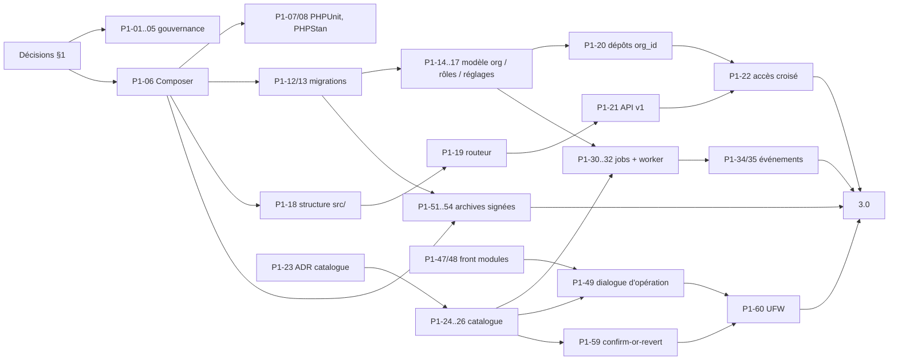

# Phase 1 — Plan détaillé

> **Statut : validé le 22/11/2026**, ainsi que les décisions du §1 (D-05, D-08, D-12, D-15, D-16, D-18, D-19, D-20) et D-23 à D-25 telles que recommandées. La Phase 1 peut commencer par la gouvernance (§11).
> **Base :** HostKeep 2.10.1. **Cible :** 3.0, livrée en plusieurs versions intermédiaires utilisables (§3).
> **Principe :** chaque tâche se termine **terminée, testée et documentée** (§6). On ne sacrifie pas l'architecture pour aller plus vite.

---

## 1. Les 8 décisions : conséquences et contraintes (validées le 22/11/2026)

Validées après présentation des conséquences ci-dessous. Pour chaque décision : ce qu'elle implique concrètement, ce qu'elle contraint, et ce qui reste à trancher.

### D-15 — Licence Apache-2.0
| | |
|---|---|
| **Conséquences** | Remplacer `LICENSE` (MIT → Apache-2.0), ajouter un fichier `NOTICE`, un en-tête `SPDX-License-Identifier: Apache-2.0` dans chaque fichier source, mettre à jour le badge du README. Les versions déjà publiées (≤ 2.10.1) restent sous MIT : c'est irréversible pour elles, et sans conséquence pratique. |
| **Faisabilité** | Tu es l'auteur unique des commits : tu peux changer la licence seul. |
| **Contraintes** | 1) **Compatibilité des dépendances** : Apache-2.0 est incompatible avec les bibliothèques **GPL-2.0 seulement** ; il faudra n'accepter que MIT, BSD, ISC, Apache-2.0, MPL-2.0 (vérification automatique en CI, tâche P1-08). 2) Apache-2.0 **ne protège pas le nom** : un tiers peut reprendre le code et vendre une version fermée, mais pas sous le nom « HostKeep » si tu définis une politique de marque (fichier `TRADEMARKS.md`, recommandé). 3) Toute modification d'un fichier doit être signalée (clause 4b) : rien à faire de plus en pratique, l'historique git le fait. |
| **Reste à trancher** | Publier ou non une politique d'usage du nom (recommandé : oui, en même temps). |

### D-12 — Fondations d'abord
| | |
|---|---|
| **Conséquences** | 10 à 12 semaines (le plan ci-dessous) avec très peu de nouveautés visibles : l'interface reste la même, en mieux (anglais, passkeys, centre de tâches, dialogue d'opération). Une seule vraie nouveauté fonctionnelle : le **pare-feu UFW** (P1-60), bâti sur le nouveau catalogue pour le valider sur un cas réel. |
| **Contraintes** | Il faut accepter de livrer des versions « techniques » (2.11, 2.12…) dont le CHANGELOG parle surtout de fiabilité. Toute demande de fonctionnalité pendant la Phase 1 attend la 3.x, sauf correctif de sécurité. |
| **Pourquoi c'est tenable** | Chaque version intermédiaire est utilisable et améliore quelque chose de mesurable (§3). |

### D-18 — Anglais comme langue de référence, français disponible
| | |
|---|---|
| **Conséquences** | 1) Interface : toutes les chaînes extraites dans `locales/en.json` et `locales/fr.json` ; l'anglais devient la langue de repli, le français reste complet et maintenu. 2) Messages du helper et du collecteur : des **codes** + paramètres traduits par l'interface. 3) Documentation : `README.md` en anglais, `README.fr.md` en français ; la doc utilisateur existe dans les deux langues, la doc de référence (API, opérations) en anglais d'abord. 4) **Commits, tickets, PR et CHANGELOG en anglais** à partir de la 2.11 (l'historique existant reste en français). 5) Les documents de `docs/strategy/` restent en français tant que tu es seul ; traduits avant d'inviter des contributeurs. |
| **Contraintes** | Environ **1 500 chaînes** à extraire (estimation) ; chaque nouvel écran coûte deux langues ; une chaîne française sans équivalent anglais doit faire échouer le CI (P1-43). Les commandes CLI gardent leurs noms ; leurs textes deviennent traduisibles. |
| **Choix à confirmer** | Langue par défaut à l'installation : celle du navigateur (recommandé), sinon anglais. |

### D-05 — Composer avec des dépendances limitées
| | |
|---|---|
| **Conséquences** | `composer.json` + `composer.lock` versionnés ; le dossier `vendor/` est **embarqué dans les archives de version** (aucun `composer install` sur les serveurs) ; une liste blanche de dépendances d'exécution (estimation : 3 à 5 — WebAuthn, validation JSON Schema, éventuellement un routeur léger) et des outils de développement (PHPUnit, PHPStan). |
| **Contraintes** | 1) **Version minimale de PHP** : Ubuntu 22.04 fournit PHP 8.1, qui n'est plus maintenu par l'équipe PHP (sécurité assurée par Canonical jusqu'en 2027). Plusieurs bibliothèques récentes exigent PHP 8.2 (à vérifier une par une en P1-06). → **nouvelle décision D-24** (§1.9). 2) Installation de développement depuis un clone : il faudra lancer `composer install` (documenté dans `CONTRIBUTING.md`). 3) Chaque dépendance est une surface d'attaque : `composer audit` et contrôle des licences bloquants en CI ; mise à jour mensuelle (Dependabot). |

### D-08 — JavaScript vanilla modulaire pour commencer
| | |
|---|---|
| **Conséquences** | `app.js` (1 575 lignes) découpé en **modules ES natifs** (un fichier par page et par composant), chargés sans étape de build ; une petite bibliothèque interne de composants (tableau, formulaire, dialogue d'opération, graphique, notifications) ; CSP stricte conservée. |
| **Contraintes** | Pas de réactivité « gratuite » : les écrans complexes (éditeur de fichiers, formulaires dynamiques) demanderont plus de code à la main ; il faut des conventions écrites (P1-45). Les navigateurs très anciens sans modules ES ne sont plus pris en charge (déjà le cas en pratique). Réévaluation formelle au début de la Phase 4. |

### D-16 — Nom « HostKeep »
| | |
|---|---|
| **Conséquences** | La **marque** s'écrit « HostKeep » partout où un humain la lit : ~117 occurrences de « Hostkeep » à remplacer (interface, e-mails, notifications, README, docs, sorties de l'installateur). Le dépôt s'appelle déjà `HostKeep`. |
| **Contrainte majeure** | Les **identifiants techniques restent en minuscules** : utilisateur système `hostkeep`, commande `hostkeep`, base `hostkeep`, services `hostkeep*.service`, chemins `/var/www/hostkeep`, `/etc/hostkeep`… (≈ 508 occurrences). Les renommer casserait toutes les installations existantes ; c'est aussi la convention habituelle (paquet `postgresql` / marque PostgreSQL). |
| **À vérifier par toi** | Disponibilité du nom (marques déposées dans les classes logiciel, nom de domaine, organisation GitHub, Docker Hub, paquets) **avant** de communiquer publiquement : je ne peux pas le vérifier pour toi de façon fiable. |

### D-19 — Version actuelle et précédente supportées
| | |
|---|---|
| **Conséquences** | Les correctifs de sécurité sont publiés pour la dernière version mineure **et** la précédente (ex. à la sortie de la 2.12 : 2.12.x et 2.11.x). Il faut garder une branche de maintenance par version supportée (`support/2.11`) et **reporter** chaque correctif ; les dates de fin de support sont publiées dans `SECURITY.md` et la doc. |
| **Contraintes** | 1) Les correctifs doivent être petits et portables : raison de plus pour des versions intermédiaires rapprochées et peu divergentes. 2) **Cas de la 3.0** : changement du mode de mise à jour (archives au lieu de git) ; la 2.x doit rester supportée jusqu'à la 3.1, et toute 2.x doit pouvoir passer en 3.0 en un clic (§4). 3) Rythme recommandé : au plus une version mineure par mois pendant la Phase 1, pour ne pas multiplier les branches à maintenir. |

### D-20 — DCO
| | |
|---|---|
| **Conséquences** | Chaque commit porte une ligne `Signed-off-by: Nom <e-mail>` (`git commit -s`), qui atteste que l'auteur a le droit de soumettre le code sous Apache-2.0 ; vérification automatique sur chaque PR (P1-03). |
| **Contraintes** | 1) **L'adresse e-mail du commit devient publique** : utilise ton adresse GitHub `noreply`. 2) Le DCO engage la personne qui signe : **c'est toi qui signes** chaque commit que tu publies. 3) Le DCO ne permet pas de changer de licence plus tard sans l'accord de chaque contributeur : c'est pourquoi la licence se décide **avant** (D-15). 4) L'historique existant n'est pas réécrit ; la règle s'applique à partir d'une date fixée. |

### 1.9 Nouvelles décisions apparues en préparant la Phase 1
| ID | Question | Options | Recommandation |
|---|---|---|---|
| **D-23** | Outil du site de documentation | (a) Markdown dans le dépôt seulement ; (b) **MkDocs Material** (Markdown, recherche, versions, multilingue, site statique) ; (c) Docusaurus (React, build Node) | (b) : rien à apprendre au-delà du Markdown, généré en CI, hébergé sur GitHub Pages |
| **D-24** | Version minimale de PHP pour la 3.0 | (a) **8.1** : garde Ubuntu 22.04, limite certaines dépendances ; (b) 8.2 : dépendances plus récentes, mais Ubuntu 22.04 n'est plus pris en charge (sauf PHP d'un dépôt tiers) | (a) pour toute la 3.x si les dépendances choisies le permettent (vérifié en P1-06) ; passage à 8.2 en 4.0 (Ubuntu 22.04 en fin de support standard en avril 2027) |
| **D-25** | Signature des archives de version | (a) **signatures SSH** (`ssh-keygen -Y sign/verify`, même clé que les tags) ; (b) minisign ; (c) sigstore/cosign | (a) : même clé, même outil déjà présent sur tous les serveurs, déjà testé en 2.10 |

---

## 2. Périmètre de la Phase 1

**Dans la Phase 1 :** les fondations (outillage, données, structure, catalogue d'opérations, tâches, événements, i18n, sécurité, distribution, documentation), les reports de la Phase 0, et une fonctionnalité visible (pare-feu UFW).
**Hors Phase 1 :** agent et multi-serveurs (Phase 2), API publique avec jetons pour tous (Phase 2), interface des organisations (Phase 6), toute autre nouvelle fonctionnalité.

---

## 3. Découpage en versions intermédiaires

Chaque version est **publiable seule** : elle fonctionne, se met à jour depuis la précédente, et a ses tests et sa documentation.

| Version | Nom | Contenu (tâches) | Ce que l'utilisateur voit |
|---|---|---|---|
| **2.11** | Socle | Gouvernance (P1-01 → 05), outillage qualité (P1-06 → 11), migrations (P1-12 → 13), reports sécurité simples (P1-38 → 41), bugs (P1-56 → 58) | Rien ne change à l'écran ; journal plus fiable, rclone sans root, nom « HostKeep », licence Apache-2.0 |
| **2.12** | Structure | Modèle de données (P1-14 → 17), structure PHP + API v1 interne (P1-18 → 22), audit chaîné (P1-37) | Rien ne change ; le front parle à `/api/v1` |
| **2.13** | Catalogue et tâches | Catalogue d'opérations (P1-23 → 29), jobs et worker (P1-30 → 33), événements (P1-34 → 35) | Dialogue d'opération (niveau de risque, aperçu), centre de tâches persistant |
| **2.14** | International et sécurisé | i18n (P1-42 → 46), front en modules (P1-47 → 50), passkeys et ré-authentification (P1-36), secrets par enveloppe (P1-39) | Interface en anglais ou en français, passkeys |
| **3.0** | Distribution | Archives signées et nouveau mode de mise à jour (P1-51 → 55), site de documentation (P1-61 → 64), pare-feu UFW (P1-59 → 60), tests de migration complets (P1-65 → 67) | Pare-feu, documentation en ligne, installation vérifiée |

---

## 4. Tâches

Format : **ID — titre** · *dépend de* · taille (S ≤ 3 j, M 1–2 sem., L 3–4 sem.) · critère de validation.

### A. Gouvernance (2.11)
| ID | Tâche | Dépend de | Taille | Validation |
|---|---|---|---|---|
| P1-01 | Licence Apache-2.0 : `LICENSE`, `NOTICE`, en-têtes SPDX, badge, `TRADEMARKS.md` | D-15 | S | Tous les fichiers source ont l'en-tête (vérifié en CI) |
| P1-02 | Marque « HostKeep » dans tous les textes visibles ; identifiants techniques inchangés | D-16 | S | Plus aucune occurrence « Hostkeep » hors historique ; installation et mise à jour 2.10.1 → 2.11 intactes |
| P1-03 | DCO : vérification sur chaque PR, `CONTRIBUTING.md` (en anglais) | D-20 | S | Une PR sans `Signed-off-by` est bloquée |
| P1-04 | Politique de versions et de support (`SECURITY.md`, `docs/`), branches `support/x.y` | D-19 | S | Dates de fin de support publiées |
| P1-05 | Modèles de tickets et de PR, code de conduite (Contributor Covenant) | — | S | Présents sur GitHub |

### B. Outillage qualité (2.11)
| ID | Tâche | Dépend de | Taille | Validation |
|---|---|---|---|---|
| P1-06 | Composer : `composer.json`/`.lock`, autoload PSR-4, choix des dépendances (version PHP minimale vérifiée) | D-05, D-24 | S | `composer validate`, aucune dépendance hors liste blanche |
| P1-07 | PHPUnit ; conversion des tests `tests/php/` existants | P1-06 | S | Mêmes tests, en PHPUnit, sur PHP 8.1 → 8.4 |
| P1-08 | CI : PHPStan (niveau 6 au départ, objectif 8), Semgrep, `composer audit`, contrôle des licences | P1-06 | M | Bloquants en CI ; base PHPStan sans erreur nouvelle |
| P1-09 | Tests d'intégration (`tests/integration/`) dans le CI : à chaque PR sur Debian 12, chaque nuit sur les 4 distributions | — | M | Job vert ; échec si une attaque passe |
| P1-10 | Tests de **mise à jour** : installer la 2.9.0 et la 2.10.1, mettre à jour vers la branche testée, rejouer les attaques | P1-09 | M | Mise à jour sans perte de comptes, réglages, sauvegardes, historique |
| P1-11 | E2E du front avec Playwright sur `tools/mock.py` (parcours principaux, 2 rôles) + axe-core | — | M | 0 violation d'accessibilité sérieuse ou critique |

### C. Données (2.11 → 2.12)
| ID | Tâche | Dépend de | Taille | Validation |
|---|---|---|---|---|
| P1-12 | Moteur de migrations versionnées (`bin/migrate`, table `schema_migrations`, verrou, journal) | P1-06 | M | Migration appliquée une seule fois ; échec = arrêt propre |
| P1-13 | Migration 0001 = schéma 2.10.1 ; détection d'une base existante (marquée appliquée sans rien rejouer) | P1-12 | S | Base 2.9 et 2.10 reconnues ; base neuve créée à l'identique |
| P1-14 | Organisations : table `organizations`, organisation « Default », colonne `org_id` sur les tables métier | P1-13 | M | Toutes les données existantes rattachées à « Default » |
| P1-15 | Rôles à portée : `roles`, `role_permissions`, `role_bindings` ; les 4 rôles actuels deviennent des rôles prédéfinis liés à « Default » | P1-14 | M | Matrice de droits **identique** à la 2.10 (test exhaustif rôle × permission) |
| P1-16 | Réglages à trois niveaux (instance, organisation, serveur) avec héritage ; réglages actuels = niveau instance | P1-14 | M | Lecture identique pour l'utilisateur ; tests d'héritage |
| P1-17 | Colonne `server_id` (serveur local par défaut) sur métriques, snapshots, contrôles de sites, tâches | P1-14 | S | Requêtes existantes inchangées pour l'utilisateur |

### D. Structure du serveur (2.12)
| ID | Tâche | Dépend de | Taille | Validation |
|---|---|---|---|---|
| P1-18 | Arborescence `src/` (Http, Domain, Operations, Security, Events, Infra) ; déplacement sans changement de comportement | P1-06 | L | Tests E2E et d'intégration inchangés |
| P1-19 | Routeur + middlewares (session, CSRF, IP autorisées, permission, organisation, limitation de débit) | P1-18 | M | Chaque route déclare sa permission ; route sans permission = erreur au démarrage |
| P1-20 | Dépôts (repositories) qui **imposent `org_id`** ; règle PHPStan : pas de SQL hors dépôts | P1-14, P1-18 | L | Règle PHPStan active ; zéro requête brute dans les contrôleurs |
| P1-21 | API `/api/v1` (contrôleurs, erreurs normalisées, OpenAPI générée) ; `api.php` conservé comme façade jusqu'à la 4.0 | P1-19 | L | Le front n'utilise plus que `/api/v1` ; l'ancienne API répond toujours (tests de compatibilité) |
| P1-22 | **Tests d'accès croisé** générés : pour chaque route, une 2e organisation de test ne voit rien de la 1re | P1-20, P1-21 | M | 100 % des routes couvertes |

### E. Catalogue d'opérations (2.13)
| ID | Tâche | Dépend de | Taille | Validation |
|---|---|---|---|---|
| P1-23 | **ADR du format du catalogue** (fichier, schéma, risques, confirmation, aperçu, réversibilité, codes de message) | — | S | ADR validé par toi avant P1-24 |
| P1-24 | Schéma JSON du catalogue + chargeur + validation au démarrage | P1-23, P1-06 | M | Catalogue invalide = refus de démarrer |
| P1-25 | Conversion des **21 verbes actuels** en définitions | P1-24 | M | Chaque verbe décrit une fois ; `ACTIONS`, `ACTION_PERMS`, `VERB_PERMS` supprimés (B7) |
| P1-26 | Génération : validation PHP, métadonnées pour le front, liste blanche du helper (vérification de parité en CI) | P1-25 | M | Divergence PHP / helper = échec du CI |
| P1-27 | Niveaux de risque et confirmations (simple, saisie du nom, ré-authentification) | P1-25, P1-36 | M | Une opération `critical` exige une ré-authentification (test) |
| P1-28 | Aperçu (« dry-run ») pour les opérations qui modifient la configuration | P1-25 | M | Aperçu disponible pour vhost, durcissement, restauration |
| P1-29 | Tests du helper **verbe par verbe** (valide, invalide, injections) générés depuis le catalogue | P1-26 | M | 100 % des verbes couverts |

### F. Tâches et événements (2.13)
| ID | Tâche | Dépend de | Taille | Validation |
|---|---|---|---|---|
| P1-30 | Tables `jobs`, `job_logs` (auteur = identifiant numérique du compte, corrige B11) | P1-14 | M | Historique interrogeable |
| P1-31 | Service `hostkeep-worker` (systemd) : file, verrous de concurrence, reprise, délais | P1-30 | L | Redémarrage du worker sans perte ; deux opérations sur la même ressource ne se chevauchent pas |
| P1-32 | Bascule des actions vers la file (le helper reste l'exécuteur) ; lecture des anciens fichiers `jobs/` jusqu'à leur purge | P1-31, P1-25 | M | Toutes les actions 2.10 passent par la file |
| P1-33 | Centre de tâches persistant dans l'interface | P1-32, P1-47 | M | Une tâche se suit après rechargement et sur un autre appareil |
| P1-34 | Événements (table `events`, outbox dans la même transaction) | P1-30 | M | Chaque fin de tâche produit un événement |
| P1-35 | Notifications et alertes branchées sur les événements (clés stables conservées) | P1-34 | M | Mêmes notifications qu'en 2.10 (tests) |

### G. Sécurité (2.11 → 2.14)
| ID | Tâche | Dépend de | Taille | Validation |
|---|---|---|---|---|
| P1-36 | Passkeys (WebAuthn) + ré-authentification récente | P1-06 | M | Connexion par passkey ; TOTP inchangé |
| P1-37 | Journal d'audit en ajout seul et chaîné (S6) ; résultats des tâches dans `jobs` ; `hostkeep audit verify` | P1-30 | M | Une modification manuelle d'une ligne est détectée |
| P1-38 | rclone sous un utilisateur dédié non root, accès en lecture aux sauvegardes | — | M | rclone ne tourne jamais en root (test d'intégration) |
| P1-39 | Secrets par enveloppe + rotation de la clé maître (`hostkeep secrets rotate`) | P1-12 | M | Rotation sans perte ; anciens secrets relus |
| P1-40 | S7 : dumps téléchargés via le helper, `root:root 600` | — | S | Le processus web ne lit plus aucun dump directement |
| P1-41 | S8 : plus de repli `HTTP_HOST` ; échecs du second facteur comptés par compte | — | S | Tests |

### H. Internationalisation (2.14)
| ID | Tâche | Dépend de | Taille | Validation |
|---|---|---|---|---|
| P1-42 | Fonction `t()` PHP et JS, catalogues `en.json` / `fr.json`, pluriels, formats de date et de nombre | P1-18 | M | Tests unitaires |
| P1-43 | Extraction de toutes les chaînes ; contrôle en CI (clé manquante, chaîne en dur) | P1-42 | L | Interface complète dans les deux langues |
| P1-44 | Codes de message du helper et du collecteur, traduits par l'interface | P1-42, P1-25 | M | Plus aucune phrase renvoyée par le helper |
| P1-45 | Langue par compte (préférence) et détection du navigateur | P1-42 | S | — |
| P1-46 | E-mails et notifications dans la langue du destinataire | P1-42, P1-35 | S | — |

### I. Front (2.13 → 2.14)
| ID | Tâche | Dépend de | Taille | Validation |
|---|---|---|---|---|
| P1-47 | Découpage de `app.js` en modules ES ; conventions écrites | — | L | Aucun fichier > 600 lignes ; E2E inchangés |
| P1-48 | Composants partagés (tableau, formulaire, dialogue, graphique, notification) | P1-47 | M | Utilisés par toutes les pages |
| P1-49 | Dialogue d'opération générique alimenté par le catalogue (paramètres, risque, aperçu, confirmation) | P1-48, P1-26 | M | Plus aucun formulaire d'action écrit à la main |
| P1-50 | `tools/mock.py` alimenté par le catalogue et l'OpenAPI (fin des données divergentes) | P1-21, P1-25 | S | — |

### J. Distribution (3.0)
| ID | Tâche | Dépend de | Taille | Validation |
|---|---|---|---|---|
| P1-51 | Archives de version (code + `vendor/`) construites en CI de façon reproductible, signées (D-25) | P1-06 | M | Même archive reconstruite à l'identique |
| P1-52 | Installateur en une ligne en deux temps : un petit script vérifie la signature de l'archive **avant** d'exécuter quoi que ce soit | P1-51 | M | Archive modifiée = refus ; testé en intégration |
| P1-53 | Mise à jour par archive (bouton et CLI), bascule atomique `releases/<version>` + `current`, sauvegarde de la base avant migration, retour arrière | P1-51, P1-12 | L | Retour arrière testé, y compris après migrations |
| P1-54 | Transition des installations git : la dernière 2.x passe d'elle-même au mode archive | P1-53 | M | 2.10.1 → 3.0 en un clic (test de mise à jour) |
| P1-55 | Canaux `stable` / `beta` | P1-53 | S | — |

### K. Bugs et dette (2.11)
| ID | Tâche | Dépend de | Taille | Validation |
|---|---|---|---|---|
| P1-56 | B3 : `managed_services()` déplacé côté collecteur | — | S | — |
| P1-57 | B4 : sondes de sites en parallèle, budget de temps, alerte « données anciennes » | — | M | 50 sites, dont 20 injoignables, collectés en moins de 60 s |
| P1-58 | B5 : métriques par point de montage | P1-13 | M | Prévision de remplissage par partition |

### L. Fonctionnalité visible (3.0)
| ID | Tâche | Dépend de | Taille | Validation |
|---|---|---|---|---|
| P1-59 | Mécanisme **confirm-or-revert** dans le helper (retour automatique sans confirmation depuis une nouvelle connexion) | P1-25 | M | Coupure simulée = retour automatique en 60 s (test en conteneur) |
| P1-60 | Pare-feu UFW (NET-02 + NET-04) : état, règles, activation, protections absolues (SSH, panel) | P1-49, P1-59 | L | Impossible de se couper l'accès (tests d'intégration) ; doc FR/EN |

### M. Documentation (2.11 → 3.0)
| ID | Tâche | Dépend de | Taille | Validation |
|---|---|---|---|---|
| P1-61 | Site de documentation (D-23), publié en CI, versionné | D-23 | M | En ligne |
| P1-62 | README en anglais + `README.fr.md` ; guide d'installation pas à pas (débutant) et référence (professionnel) | P1-61 | M | — |
| P1-63 | Référence générée : API (OpenAPI) et opérations (catalogue) | P1-21, P1-25 | M | Toute route et toute opération documentées (CI) |
| P1-64 | Guide de mise à jour 2.x → 3.0 et guide d'architecture pour contributeurs (en anglais) | P1-54 | S | — |

### N. Publication de la 3.0
| ID | Tâche | Dépend de | Taille | Validation |
|---|---|---|---|---|
| P1-65 | Matrice complète : installation neuve et mise à jour depuis 2.9.0 et 2.10.1, sur les 4 distributions × Nginx/Apache/Caddy/proxy | toutes | M | 100 % vert |
| P1-66 | Bêta publique (canal `beta`) pendant au moins 2 semaines | P1-55 | — | Aucun bug bloquant ouvert |
| P1-67 | Mesures de référence (RAM, CPU, durée de collecte, Lighthouse) comparées à la 2.10.1 | — | S | Pas de régression > 10 % |

---

## 5. Dépendances (chemin critique)

**Chemin critique :** décisions → Composer → migrations → modèle de données → dépôts → API v1 → catalogue → jobs → dialogue d'opération → UFW → 3.0. Les tâches de gouvernance, de documentation, de sécurité (P1-36 à P1-41) et de front (P1-47, P1-48) peuvent avancer en parallèle.

---

## 6. Définition de « terminé »

Une tâche n'est terminée que si :
1. **Code** relu, lisible, sans duplication de règle (une seule source : le catalogue, les dépôts).
2. **Tests** : unitaires pour la logique, intégration pour tout ce qui touche au système, E2E pour ce qui change à l'écran ; CI verte sur PHP 8.1 → 8.4.
3. **Sécurité** : permission déclarée, portée d'organisation respectée, action journalisée, entrées validées des deux côtés (central et helper).
4. **Compatibilité** : mise à jour depuis la version précédente testée (P1-10).
5. **Documentation** : guide utilisateur FR et EN si visible, référence à jour, CHANGELOG, et `docs/strategy/` mis à jour (statut des constats et des écarts).
6. **Traductions** : aucune chaîne en dur.

---

## 7. Compatibilité avec les installations existantes

| Sujet | Règle | Comment c'est garanti |
|---|---|---|
| Chemin de mise à jour | Toute 2.x ≥ 2.9 passe en 2.11, …, 3.0 par le bouton ou `sudo hostkeep update`, sans intervention | Tests de mise à jour P1-10 et P1-65 sur chaque PR concernée |
| Base de données | Migrations **uniquement en avant**, idempotentes ; base existante reconnue (P1-13) ; **sauvegarde automatique de la base avant toute migration** | Retour arrière = restauration de cette sauvegarde + code précédent (P1-53) |
| Comptes et droits | Les 4 rôles deviennent des rôles prédéfinis ; droits **strictement identiques** | Test exhaustif rôle × permission avant/après (P1-15) |
| Réglages, secrets | Réglages actuels = niveau instance ; secrets actuels relus puis rechiffrés par enveloppe | Tests de migration des secrets (P1-39) |
| Identifiants système | `hostkeep` (utilisateur, commande, base, services, chemins) **inchangés** | Revue + tests d'installation |
| `.env` | Clés existantes conservées ; nouvelles clés optionnelles avec valeur par défaut | — |
| API | `api.php` reste une façade de `/api/v1` jusqu'à la 4.0 | Tests de compatibilité de l'ancienne API |
| Tâches en cours pendant la mise à jour | Les anciens fichiers `jobs/` restent lisibles jusqu'à leur purge (7 jours) | P1-32 |
| Mises à jour signées | Une installation configurée avec une clé n'accepte que des versions signées, y compris pour passer au mode archive | P1-54 testé avec et sans clé |
| Retour arrière | « Revenir à… » fonctionne sur au moins une version, migrations comprises | P1-53 |
| Support | 2.10.x reçoit les correctifs de sécurité jusqu'à la sortie de la 2.12 (D-19) ; 2.x au total jusqu'à la 3.1 | Branches `support/x.y` |

---

## 8. Tests à mettre en place

| Niveau | Outil | Portée | Quand |
|---|---|---|---|
| Unitaires PHP | PHPUnit | Validateurs, RBAC, catalogue, migrations, i18n, secrets, TOTP, WebAuthn | Chaque PR, PHP 8.1 → 8.4 |
| Analyse statique | PHPStan (+ règles maison), Semgrep, shellcheck | Tout le code ; SQL hors dépôts interdit | Chaque PR |
| Helper | Tests bash générés depuis le catalogue | Chaque verbe : valide, invalide, injections | Chaque PR |
| Contrat | Tests générés depuis l'OpenAPI | Chaque route : codes, schémas, permissions | Chaque PR |
| Accès croisé | Générés depuis les routes | Isolation entre organisations | Chaque PR |
| E2E | Playwright + axe-core sur `tools/mock.py` | Parcours principaux, 2 rôles, 2 langues, mobile | Chaque PR |
| Intégration | `tests/integration/` (conteneurs systemd) | Installation, attaques, mises à jour depuis 2.9.0 et 2.10.1 | Chaque PR (Debian 12) ; chaque nuit (4 distributions × 4 modes web) |
| Sécurité des dépendances | `composer audit`, licences, gitleaks, Dependabot | — | Chaque PR + chaque semaine |
| Performance | Mesures de référence (P1-67) | RAM, CPU, collecte, poids du front | Avant chaque version |

---

## 9. Risques

| Risque | Probabilité | Impact | Parade |
|---|---|---|---|
| Régression pendant la restructuration (P1-18 à P1-21) | Élevée | Élevé | Déplacements sans changement de comportement, E2E et intégration avant de commencer, une PR par module |
| Perte de données lors d'une migration | Faible | Très élevé | Sauvegarde avant migration, migrations testées sur des bases 2.9 et 2.10 réelles, retour arrière testé |
| Dépendances incompatibles avec PHP 8.1 | Moyenne | Moyen | Vérifié en P1-06 avant tout choix ; décision D-24 |
| Ampleur de l'i18n (≈ 1 500 chaînes) | Élevée | Moyen | Extraction outillée, contrôle en CI, une page à la fois |
| Dérive du périmètre (« tant qu'on y est ») | Élevée | Élevé | Toute nouvelle fonctionnalité hors UFW refusée en Phase 1 ; liste des reports tenue à jour |
| Verrouillage d'un serveur par le pare-feu | Moyenne | Très élevé | Confirm-or-revert + protections absolues + tests de coupure en conteneur |
| Perte de la clé de signature | Faible | Très élevé | Copie hors ligne (`docs/RELEASING.md`), procédure de rotation testée |
| Transition git → archives ratée sur des installations modifiées à la main | Moyenne | Élevé | Détection et message clair ; mode « développeur » conservé ; tests avec dépôt modifié |
| Charge du mainteneur unique (support de 2 versions + Phase 1) | Élevée | Élevé | Versions intermédiaires petites ; une mineure par mois au plus ; automatisation des reports |
| Worker : nouveau service qui peut tomber | Moyenne | Moyen | Supervision systemd, alerte « worker arrêté », reprise des tâches |

---

## 10. Estimation

| Version | Contenu | Durée indicative (une personne à temps plein) |
|---|---|---|
| 2.11 | Socle | 2–3 semaines |
| 2.12 | Structure | 3–4 semaines |
| 2.13 | Catalogue et tâches | 3–4 semaines |
| 2.14 | International et sécurisé | 2–3 semaines |
| 3.0 | Distribution, documentation, UFW, bêta | 3–4 semaines + 2 semaines de bêta |

**Total : 13 à 18 semaines**, soit plus que les 8 à 10 semaines prévues dans la roadmap : l'écart vient du découpage en versions publiables, des tests de mise à jour systématiques et de la bêta. Je recommande de garder ce rythme plutôt que de réduire la qualité.

---

## 11. Premières étapes après validation

1. Tu valides (ou modifies) les 8 décisions du §1 et tranches D-23, D-24, D-25.
2. P1-01 à P1-05 (gouvernance) : une PR, que tu signes (DCO).
3. P1-06 (Composer, avec vérification de la version minimale de PHP), puis P1-07 à P1-11 (outillage) : à partir de là, chaque changement est couvert.
4. P1-23 : je rédige l'ADR du catalogue d'opérations pour validation, en parallèle des migrations (P1-12, P1-13).
