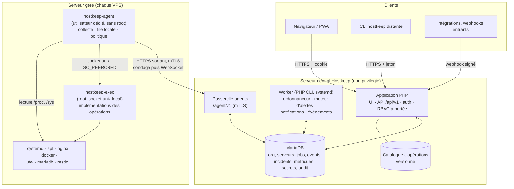

# Architecture cible

> **Statut :** proposition. Les choix structurants marqués **⚑** attendent une validation (détail et alternatives dans `TECHNICAL_DECISIONS.md`).
> **Principe directeur :** **faire évoluer** l'architecture actuelle, pas la réécrire. Le modèle « processus web non privilégié + exécuteur root en liste blanche » est sain : la cible le généralise à N serveurs.

---

## 1. Principes

1. **Opérations typées, jamais de shell.** Tout ce qui modifie un serveur est une *opération* du catalogue : paramètres typés, validation, permission, niveau de risque, effets annoncés, réversibilité. L'interface, l'API, les automatisations et l'IA ne peuvent rien demander d'autre.
2. **Moindre privilège à chaque saut.** Navigateur → serveur central (non privilégié) → agent (non privilégié) → exécuteur local (root, liste blanche). Aucun composant réseau ne tourne en root.
3. **L'agent appelle, on ne l'appelle pas.** Les serveurs gérés n'ouvrent aucun port entrant pour Hostkeep.
4. **Mono-serveur = cas particulier du multi-serveurs.** Une installation simple reste « un central + un agent local » sur la même machine, installés par la même commande.
5. **L'état est en base, pas dans des fichiers.** Tâches, événements, incidents, résultats : interrogeables, historisés, scopés par organisation.
6. **Transport interchangeable.** Le protocole agent est défini indépendamment du transport (sondage HTTPS d'abord, WebSocket ensuite).
7. **Évolution incrémentale.** Chaque étape de migration livre une version utilisable.

---

## 2. Vue d'ensemble



### Correspondance avec l'existant

| Aujourd'hui | Cible | Nature du changement |
|---|---|---|
| `app/public/api.php` (switch de routes) | Routeur + contrôleurs par module, `/api/v1` versionnée | Découpage, pas de réécriture |
| `ACTIONS` + `ACTION_PERMS` + `VERB_PERMS` + `validate()` | **Catalogue d'opérations** unique | Fusion de 4 listes en 1 |
| `sudo hostkeep-action job …` depuis PHP | PHP **enfile** un job ; l'agent local le prend et l'exécute | PHP n'appelle plus `sudo` → `NoNewPrivileges=yes` possible sur PHP-FPM |
| `system/hostkeep-action` (bash root) | `hostkeep-exec` (root) — d'abord **l'actuel helper**, appelé par l'agent ; réimplémenté progressivement | Réutilisation puis remplacement |
| `app/bin/collect.php` (root, timers) | Collecte dans l'agent (non root) + calculs (alertes, notifications) dans le worker central | Séparation collecte / analyse ; le root ne lit plus de réglages écrits par le web (corrige S1 structurellement) |
| `jobs/*.log`, `*.rc` | Tables `jobs`, `job_logs` | Historique, file, priorités, reprise |
| `snapshots` (dernier état JSON) | `inventory` par serveur + `snapshots` scopés `server_id` | Ajout de la clé serveur |
| `metrics` (1 ligne/min, 1 serveur) | `metrics_*` partitionnées + agrégats, `server_id` | Changement de schéma |
| 4 rôles fixes globaux | Rôles (prédéfinis + personnalisés) × portée (org, groupe, serveur, ressource) | Extension du RBAC |

---

## 3. Composants

### 3.1 Serveur central (« control plane »)
- **Langage :** PHP 8.2+ (on reste sur l'existant) ⚑ D-02. Composer autorisé pour l'autoload PSR-4, les outils de développement et un nombre réduit de bibliothèques auditées (WebAuthn, JSON Schema) ⚑ D-05.
- **Structure cible du code :**
  ```
  src/
    Http/          routeur, middlewares (session, CSRF, jeton, org, permission, rate limit), contrôleurs
    Domain/        Servers, Sites, Containers, Databases, Backups, Firewall, Users, Alerts, Incidents…
    Operations/    catalogue (définitions), planification, aperçu, résultats
    Agents/        enrôlement, passerelle, protocole
    Security/      auth, MFA, WebAuthn, RBAC, secrets (enveloppe), audit chaîné
    Events/        bus (outbox), consommateurs
    Infra/         DB, migrations, i18n, mailer, HTTP client
  public/          index.php (front controller), assets
  bin/             hostkeep-worker, migrate, user
  ```
- **Processus :** PHP-FPM (requêtes web, API, passerelle agents en sondage) + **`hostkeep-worker`** (service systemd, PHP CLI, boucle) pour l'ordonnancement, les événements, les alertes, les notifications, les rapports.
- **Privilèges :** utilisateur `hostkeep`, **aucun sudo**, `NoNewPrivileges`, `ProtectSystem=strict`, `PrivateDevices`, `RestrictAddressFamilies=AF_UNIX AF_INET AF_INET6`.

### 3.2 Agent
- **Langage :** Go (binaire statique, ~10–15 Mo, sans dépendance, multi-architecture) ⚑ D-03.
- **Deux processus, deux niveaux de privilège** (même principe que web/helper aujourd'hui) :
  - **`hostkeep-agent`** — utilisateur système dédié, sans root. Réseau sortant, collecte (`/proc`, `/sys`, cgroups), file locale (SQLite) quand le central est injoignable, application de la **politique locale**.
  - **`hostkeep-exec`** — root, activé par socket systemd (rien au repos), n'écoute **que** sur un socket unix local, vérifie l'appelant (`SO_PEERCRED` = utilisateur de l'agent), ne connaît que les opérations compilées dans sa version, revalide chaque paramètre. Chaque exécution dans une unité transitoire `systemd-run` avec durcissement adapté à l'opération (ex. `ReadWritePaths=` limités).
- **Politique locale** (`/etc/hostkeep/agent-policy.yaml`, root, non modifiable à distance par défaut) : liste d'opérations ou de catégories refusées sur ce serveur (ex. interdire `files.write` ou `firewall.*`). Un central compromis ne peut pas outrepasser la politique locale.
- **Transition :** en phase 2, `hostkeep-exec` délègue aux fonctions de l'actuel `hostkeep-action` (Bash) ; elles sont réécrites en Go une par une, avec tests.

### 3.3 Base de données
- **MariaDB** conservée ⚑ D-06 (déjà installée, maîtrisée, accès socket sans mot de passe).
- **Migrations versionnées** (`migrations/NNNN_description.sql` + table `schema_migrations`), exécutées par `bin/migrate` à l'installation et à la mise à jour. `schema.sql` actuel = migration 0001.
- **Agent :** SQLite local pour la file hors ligne et les métriques en attente.

### 3.4 Front-end
- Vanilla JS conservé, découpé en **modules ES natifs** (un fichier par page/composant), sans étape de build ⚑ D-08. Composants de base (tableau, formulaire, dialogue d'opération, graphique) partagés.
- Le front reçoit du serveur la **description des opérations** (paramètres, libellés, risque) : les formulaires et les permissions ne sont plus codés en double.

---

## 4. Catalogue d'opérations

Le cœur de l'architecture. Une opération est déclarée **une fois** ; tout le reste en découle.

```yaml
# operations/service.restart.yaml (exemple illustratif)
id: service.restart
version: 1
category: services
risk: routine            # read | routine | change | destructive | critical
permission: services.operate
scope: server            # org | server | resource
params:
  unit: { type: string, pattern: "^[a-z0-9@._-]{1,64}\\.service$", source: inventory.services }
  mode: { type: enum, values: [restart, reload], default: restart }
preview: true            # l'agent sait décrire ce qui va se passer (dry-run)
reversible: false
confirm: simple          # none | simple | typed | reauth | four_eyes
timeout: 120s
concurrency: "service:{unit}"   # pas deux opérations sur la même unité en même temps
emits: [service.restarted, service.restart_failed]
i18n: ops.service.restart
```

- **Côté central :** validation (JSON Schema), contrôle de permission et de portée, niveau de confirmation, création du job, aperçu, audit.
- **Côté agent :** revalidation complète (le central n'est pas cru sur parole), politique locale, exécution, retour structuré (`code`, `message_key`, `params`, `changes[]`, `rollback_token?`).
- **Effets et réversibilité :** une opération `reversible: true` renvoie un *jeton de retour arrière* (ex. copie de la configuration précédente) utilisable par `*.rollback` pendant une durée donnée.
- **Versionnement :** le catalogue est livré avec l'agent ; à la connexion, l'agent annonce ses opérations et versions (*capabilities*). Le central n'affiche que ce que l'agent sait faire.
- **Niveaux de risque et confirmations** : voir `SECURITY_ROADMAP.md` §4.

---

## 5. Communication central ↔ agents

### 5.1 Enrôlement
1. Un administrateur crée un serveur dans l'interface → jeton d'enrôlement **à usage unique**, valable 1 h, lié à l'organisation.
2. Sur le serveur : `curl … | sudo bash -s -- --join https://central --token XXXX` (script signé) installe l'agent.
3. L'agent génère une paire de clés (Ed25519 / ECDSA P-256), envoie une CSR + le jeton ; le central signe un **certificat client** (CA interne Hostkeep, durée 90 j, renouvellement automatique) et renvoie l'empreinte de sa propre CA (épinglée par l'agent).
4. Le serveur apparaît dans la flotte ; empreinte affichée des deux côtés pour vérification optionnelle.

### 5.2 Transport ⚑ D-04
- **Version 1 — sondage HTTPS** (`/agent/v1/*` servi par l'application PHP) : l'agent appelle `poll` toutes les 30 s au repos, toutes les 2 s quand un job le concerne ; envoie ses métriques par lots chaque minute. Simple, compatible avec tous les proxies, réutilise la pile existante. Suffisant jusqu'à ~100–200 serveurs.
- **Version 2 — WebSocket** via une passerelle Go dédiée (`hostkeep-gateway`, même base de code que l'agent) quand le besoin de temps réel (journaux en direct, console) ou l'échelle l'exige. Le protocole (messages JSON) ne change pas.

### 5.3 Sécurité du canal
- TLS 1.3, **mTLS** (certificat client par agent), révocation par serveur.
- Chaque demande d'opération est **signée** par le central (clé Ed25519 dédiée, distincte de la CA), avec `job_id`, `nonce`, `expires_at` (≤ 5 min) et le hachage des paramètres : un proxy ou un relais ne peut ni injecter ni rejouer.
- Les secrets nécessaires à une opération (ex. clé de dépôt restic) sont **chiffrés pour la clé publique de l'agent** et jamais stockés en clair sur le serveur géré au-delà du besoin.
- L'agent ne reçoit jamais de commande shell ; un message inconnu est rejeté et journalisé.

---

## 6. Tâches, file et événements

### 6.1 Cycle de vie d'un job
```
draft (aperçu) → pending → [awaiting_approval] → queued → dispatched → running → succeeded | failed | cancelled | timed_out
                                                                                  └→ rolled_back (si demandé)
```
- Table `jobs` : `id` (UUID), `org_id`, `server_id`, `operation`, `op_version`, `params` (JSON), `risk`, `requested_by`, `approved_by`, `status`, horodatages, `result` (JSON), `parent_id` (opérations groupées), `schedule_id`.
- Table `job_logs` : morceaux de sortie (ordonnés), purge configurable.
- Verrous de concurrence par clé (`concurrency`), priorité, délai max, reprise après redémarrage du worker.
- Opérations groupées (N serveurs) = un job parent + N enfants, avec stratégie (en série, par lots, arrêt au premier échec).

### 6.2 Événements (outbox)
- Table `events` (`id`, `org_id`, `server_id`, `type`, `payload`, `created_at`, `processed_at`). Écrite dans la **même transaction** que le changement d'état.
- Consommateurs du worker : moteur d'alertes → incidents, notifications, webhooks sortants signés (HMAC), automatisations, audit enrichi, rapports.
- Types nommés `domaine.objet.verbe` (`backup.run.failed`, `site.check.down`, `job.finished`, `agent.connection.lost`).

### 6.3 Alertes et incidents
- **Règles déclaratives** (métrique ou événement, condition, durée, portée, gravité, canal) ; les 17 règles actuelles deviennent les règles par défaut.
- Une alerte a une **clé stable** (`rule:server:resource`) → corrige le spam de notifications (B2).
- **Incident** = période pendant laquelle une alerte est active : ouverture, accusé de réception, commentaires, résolution, durée. Silences et fenêtres de maintenance.

---

## 7. Modèle de données (extrait)

```
organizations(id, name, slug, created_at)
users(id, …)                               -- existant, sans rôle global
memberships(user_id, org_id, role_id)      -- appartenance
teams(id, org_id, name) · team_members(team_id, user_id)
roles(id, org_id NULL=prédéfini, name) · role_permissions(role_id, permission)
role_bindings(id, principal_type user|team|token, principal_id, role_id, scope_type org|server_group|server|resource, scope_id)
servers(id, org_id, name, labels JSON, agent_version, os, arch, cert_fingerprint, last_seen_at, status)
server_groups(id, org_id, name) · server_group_members
resources(id, org_id, server_id, type site|stack|database|volume…, external_id, managed BOOL, data JSON)
jobs · job_logs · schedules
events · alert_rules · incidents · incident_events · silences
secrets(id, org_id, name, ciphertext, dek_wrapped, key_version, created_by, rotated_at)
api_tokens(id, org_id, user_id NULL, name, hash, scopes JSON, ip_allow, expires_at, last_used_at)
audit_log(id, org_id, ts, actor, ip, action, target, job_id, details JSON, prev_hash, hash)
metrics_host_1m(server_id, ts, …) · metrics_host_5m · metrics_host_1h   -- partitionnées par jour/mois
metrics_disk_1m(server_id, mount, ts, …) · metrics_container_1m(server_id, container, ts, …)
```

- **Isolation multi-organisations :** chaque accès passe par une couche de dépôts qui **impose** `org_id` ; aucun SQL brut dans les contrôleurs ; tests automatiques d'accès croisé (voir sécurité).
- **Mono-organisation par défaut :** l'installation crée l'organisation « Default » ; l'interface masque la notion tant qu'il n'y en a qu'une.

### Volumétrie et rétention des métriques
| Résolution | Rétention par défaut | Lignes / serveur |
|---|---|---|
| 1 min | 7 jours | ~10 000 |
| 5 min | 35 jours | ~10 000 |
| 1 h | 13 mois | ~9 500 |

≈ 30 000 lignes « hôte » par serveur, soit ~3 M lignes pour 100 serveurs (+ disques et conteneurs) : confortable pour MariaDB avec partitionnement. Au-delà de quelques centaines de serveurs, **extension** vers VictoriaMetrics/Prometheus ⚑ D-07.

---

## 8. API

- **REST JSON versionnée** : `/api/v1/…`, description **OpenAPI 3.1** générée depuis les routes et le catalogue.
- **Ressources** : `/servers`, `/servers/{id}/services`, `/sites`, `/stacks`, `/databases`, `/backups`, `/jobs`, `/incidents`, `/events` (+ flux SSE), `/operations` (catalogue), `/operations/{id}:preview`, `/operations/{id}:run`.
- **Authentification** : cookie de session (UI, avec CSRF) ou **jeton porteur** (`Authorization: Bearer hk_…`), haché en base, avec portées (`servers:read`, `operations:run:routine`…), expiration, restriction IP.
- **Limitation de débit** par jeton et par IP ; idempotence des POST par en-tête `Idempotency-Key`.
- L'API **est** l'interface : le front n'utilise que des routes publiques documentées.

---

## 9. Extensions

Approche progressive, du moins risqué au plus risqué ⚑ D-10 :

| Niveau | Contenu | Exécution | Phase |
|---|---|---|---|
| 1. Intégrations | Canaux de notification, fournisseurs DNS, destinations de sauvegarde | Classes PHP dans le central, interface stricte, **revue et signature** par le projet | P3 |
| 2. Paquets d'opérations | Nouvelles opérations (ex. WordPress, Redis) | Manifeste + implémentation livrée **avec l'agent** sous forme de module signé ; exécution par `hostkeep-exec` dans une unité systemd fortement confinée | P3+ |
| 3. Panneaux d'interface | Écrans supplémentaires | Module ES chargé dans une **iframe sandboxée** communiquant par `postMessage` avec une API limitée | Plus tard |

- Toute extension déclare les permissions et opérations qu'elle demande ; l'administrateur les accepte à l'installation ; signature obligatoire (clé du projet ou clé d'un éditeur explicitement approuvée).
- Pas d'exécution de code PHP tiers non signé dans le processus central.

---

## 10. Mises à jour

- **Releases signées** (archive + signature minisign ou sigstore), sur **tags** ; canal `stable` / `beta` ⚑ D-11.
- **Central :** téléchargement, vérification de signature, migrations, bascule atomique (`releases/<version>` + lien `current`), retour arrière si la vérification de santé échoue.
- **Agents :** mis à jour par le central, **par vagues** (1 serveur, puis 10 %, puis tous), avec retour automatique si l'agent ne se reconnecte pas dans les 2 minutes.
- **Compatibilité :** le central supporte les agents de version N et N-1 ; le protocole porte un numéro de version.

---

## 11. Compatibilité Linux

- **Supportées d'emblée :** Debian 12/13, Ubuntu 22.04/24.04 (et suivantes), amd64 et arm64.
- **Ensuite :** RHEL / AlmaLinux / Rocky 9+, via une couche d'abstraction dans l'agent (`PackageManager` apt|dnf, chemins des serveurs web, noms de services, pare-feu firewalld).
- **Détection** à la connexion : distribution, version, init (systemd requis), serveur(s) web, Docker, pare-feu disponible ; l'interface n'affiche que ce qui est possible.

---

## 12. Performances visées

| Composant | Cible | Moyen |
|---|---|---|
| Agent au repos | ≤ 25 Mo RSS, ≤ 1 % d'un vCPU en moyenne | Go, collecte toutes les 60 s (10 s en mode « direct »), pas de shell pour la collecte |
| Exécuteur | 0 au repos | Activation par socket |
| Central, 1 serveur | ≤ 60 Mo hors MariaDB au repos | FPM `ondemand`, worker unique |
| Central, 100 serveurs | ≤ 300 Mo hors MariaDB ; < 30 req/s soutenues | Sondage espacé, insertion par lots |
| API (lecture) | p95 < 150 ms | Index, agrégats |

---

## 13. Chemin de migration

| Étape | Contenu | Livrable utilisable |
|---|---|---|
| M0 | Correctifs sécurité (S1–S5, B1, B2), tests | 2.10 |
| M1 | Migrations versionnées ; routeur + modules ; i18n ; **catalogue d'opérations** généré depuis les 21 verbes actuels ; jobs en base | 3.0 (mono-serveur, même périmètre, base saine) |
| M2 | `server_id` partout (serveur local par défaut) ; agent local Go qui remplace l'appel `sudo` depuis PHP ; `hostkeep-exec` délègue au helper Bash | 3.1 (PHP sans sudo) |
| M3 | Enrôlement d'agents distants, vue flotte, opérations groupées | 3.2 (multi-serveurs) |
| M4 | Organisations, rôles à portée, jetons d'API publics | 3.3 |
| M5+ | Fonctionnalités par domaine, extensions, passerelle WebSocket | 3.x / 4.0 |

---

## 14. Verdict : évolution ou refonte ?

| Critère | Architecture actuelle | Verdict |
|---|---|---|
| Modèle de sécurité | Excellent principe, généralisable | **Conserver** |
| Langage et pile (PHP natif, MariaDB, systemd) | Adaptés au central, sans dette majeure | **Conserver**, structurer |
| Helper Bash | Bon pour 20 verbes, pas pour 200 | **Encapsuler** puis remplacer progressivement (Go) |
| Collecteur root | Mélange collecte et logique, lit des réglages web | **Scinder** : collecte → agent, logique → worker |
| Mono-serveur codé en dur | Bloquant pour la vision | **Généraliser** via `server_id` + agent |
| Front vanilla | Léger, accessible, mais monolithique | **Découper** en modules |

**Conclusion :** aucune refonte complète n'est justifiée. Le passage à « central + agent » est une **extraction** de composants qui existent déjà (le helper et le collecteur sont, de fait, un agent local), pas un changement de philosophie.
